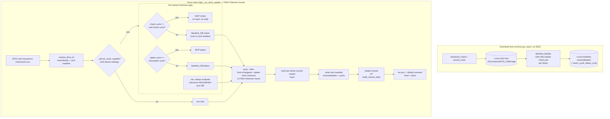

# Design Document: Chart Manifest Sync

## Overview

This feature replaces the EFIS chart-drive sync engine's correctness mechanism
and its write mechanism. It does two things at once because the two are
entangled in the code being retired:

1. **Correctness.** Today the chart tree is synced with `rsync --size-only`
   (see `drive_updater.sync_payload`). That flag has a real correctness gap: a
   chart file revised to the **same byte size but different content** is
   compared equal and **skipped**, so the drive silently keeps a stale file.
   The field investigation (`INVESTIGATION-2026-10-24.md`) also established that
   file timestamps are **not** a reliable correctness signal on these charts
   (SEC/LO mtime/ctime reset to extract-time, birthtime is uniform, Plates
   varied), so neither size nor time can be trusted. The only correct mechanism
   is **content hashing**. This design introduces a **SHA-256 manifest** of the
   chart tree, computed at download time on the fast SSD, and diffs it against a
   manifest stored **on the card** to drive sync. nav already hashes its two
   files (`_run_files_job` / `_file_checksum`) and keeps doing so.

2. **Write path.** The `chart-sync-stall-fix` spec adopted a *mount-swap* layer
   (`mount_swap.msdos_mount`) to dodge an FSKit stall, and `image-based-drive-write`
   added a raw `dd` image path (`image_writer`, `image_composer` compose/write,
   `image_write_enabled`). Benchmarking since then showed a plain
   `rsync --delete` to the ordinary **FSKit `/Volumes` mount** completes a full
   worst-case rewrite (~102k files / ~11.6 GB) in **~203 min with no hang**, on
   both direct USB-C and a dock. So the write path becomes **rsync to the plain
   FSKit mount** — no mount-swap, no image-dd. This design **supersedes
   `chart-sync-stall-fix`** and retires both the mount-swap and image-dd paths.

The engine gains **three independent data streams** with different freshness
rules, each gated cheaply before any expensive work:

- **charts** (SEC + LO + **HI** when enabled — the "scanned" family) on the
  **56-day** cycle, gated by a single **charts cycle number**. IFR High (`HI`)
  is on the same 56-day cycle as SEC/LO and rides the same charts-cycle gate;
  it is NOT a separate stream. It is optional (config `chart_types.ifr_high`,
  default off). See "IFR High" under Components for the extraction fix it
  requires.
- **plates** on the **28-day** cycle (twice as frequent), gated by a **separate
  plates cycle number**.
- **nav** (NAV.DB, NAV-proc.DB) — **no cycle gate**, always evaluated,
  checksum-based, cheap (~18 MB). nav is nominally on a 28-day cycle (per GRT:
  "The Nav database is on a 28-day cycle. New updates are posted when we receive
  them"), but there is **no cycle number we can gate on**: none appears on the
  download page or in the filename (it may be embedded inside the DB contents,
  but we do not parse that), and the only external clue is a human-readable date
  on the page. Posting is also best-effort and may not line up with Seattle
  Avionics' plates cycle. Since no reliable cycle number exists and the payload
  is tiny (~18 MB, two files), nav is evaluated by content checksum on every
  insert — the correct, gate-free mechanism.

Layering per chart family, cheapest first: **cycle-number check → (only if the
cycle rolled) manifest diff → write only the delta**. On an alternating cycle
(plates rolled, charts did not), the ~5.5 GB charts half is skipped wholesale by
the cycle check before any hashing or writing.

### The honest tradeoff

Measured cycle-to-cycle churn (2609 → 2611) is **~74% of files changed**; only
~26% are unchanged (26,410 of 102,011). So even with a perfect manifest diff, a
full both-cycles-rolled sync still writes ~75k files / ~7.5 GB / ~2.5 h. The
manifest diff is **not primarily a speed win** — within a changed family it only
saves the ~26% unchanged. The wins are, in order:

1. **Correctness** — the non-negotiable. The `--size-only` gap is closed; a
   same-size content change is now always detected and written.
2. **Whole-family cycle skip** — when a family's cycle has not rolled, the
   entire family (up to ~5.5 GB) is skipped with a single integer comparison.
3. **Per-file skip** — the ~26% unchanged within a rolled family.

This document is explicit about that so the plan is not oversold: the manifest
is bought for correctness first, speed second.

**Chart-type selections are independent, and enabling IFR High is expensive in
TIME though cheap in bytes.** The user-facing products (config toggle in parens): **sectionals** (SEC,
`sectional`); **plates** = approach plates / airport diagrams / procedures (the Plates
family, `approach_plates`); **low** = IFR low-altitude enroute (LO, `ifr_low`);
**high** = IFR high-altitude enroute (HI, `ifr_high`). (The `sectional` toggle
also pulls the small `ScannedCharts.sqlite` catalog DB via its
`["sectional","scanned charts"]` matcher — a bundled marker, not a
pilot-selected product.) The meaningful real-world selections are:
- **VFR** = sectionals (+ plates if desired).
- **IFR** = sectionals + low + plates — an IFR pilot ALWAYS carries all three;
  this is the minimum IFR set.
- **IFR + high** = the above + high (aircraft-dependent; many IFR aircraft
  never operate above 18,000 ft and omit it).

Mapping to SYNC FAMILIES: **plates** is its own family on the **28-day** cycle;
sectionals + low + high are the **scanned** family on the **56-day** cycle (the
scanned family is the union of whichever of SEC/LO/HI are enabled, plus the
ScannedCharts.sqlite marker). Measured 2611 per-family counts:
SEC 39,901 files / 4.5 GB; LO 39,866 files / 1.0 GB; **HI 108,712 files /
~450 MB**; Plates 22,242 files / 3.7 GB. The key point: HI is small in BYTES
but has the **largest FILE COUNT** of the three chart families — ~2.7x SEC or
LO. Because the sync is per-file-metadata-bound on FAT (measured ~7-13 files/s,
not byte-bound), **enabling HI adds roughly its own multi-hour sync cost** (~109k
files at ~10 files/s ≈ ~3 h) despite being only ~450 MB. So the ~2.5 h figure
above (measured WITHOUT High) understates the sync time for an IFR-high user.
The manifest + cycle gate apply uniformly regardless; HI just adds many small
files to the same mechanism, and the per-file cost dominates.

### Supersedes `chart-sync-stall-fix`

`chart-sync-stall-fix` adopted `mount_msdos` to escape an FSKit write stall. The
later field investigation (`INVESTIGATION-2026-10-24.md`) **retracted** the
premise that FSKit FAT32 writes are unusable: the mount itself was never the
problem, and subsequent benchmarking showed a plain `rsync --delete` to the
FSKit mount completes a full chart rewrite cleanly with no hang. The mount-swap
layer solved a problem that, with correct sync behavior and no pipe-buffer
deadlock (already fixed in `sync_payload` via temp-file stdout draining), does
not require elevated privilege or a private mountpoint. This spec therefore
retires the mount-swap (and the parallel image-dd experiment) and keeps the
engine on the simple, measured-reliable FSKit path. See
[Retirement plan](#retirement-plan).

---

## Architecture

The pipeline is **download → hash (async, SSD) → on insert: per-stream gate →
manifest diff → rsync the delta → write card manifest → relabel → flush**.



### Where the change lands in the existing code

- **`currency.py`** — after a successful `extract_chart`, kick off an async
  **manifest build** of the affected family on the SSD and persist it locally
  alongside `chart_cycles.json`. Cycle numbers are harvested here too (they are
  embedded in the SA download URLs, e.g. `...2611...`, and in `valid_dates`).
- **`currency._extract_multidisk` (IFR High extraction fix, REQUIRED)** —
  today this routes MultiDiskImg files to `LO/` or `SEC/` by the `.LO.`/`.SEC.`
  token in the filename, and anything else falls to `else: sub_dir = ""` —
  i.e. dumped loose into `ChartData/` root. IFR High files are named
  `<cycle>/W###/<tile>.HI.<n>.png` (verified by inspecting the real 2611 HI
  zip: 108,712 members, same `<cycle>/<tile-dir>/<file>` layout as LO/SEC). So
  with High enabled TODAY, all ~109k HI files are mis-placed flat at ChartData
  root — a latent correctness bug (the user does not currently enable High, so
  it is untested in the field). FIX: add an `.HI. -> HI/` routing branch,
  parallel to LO/SEC, placing files at `ChartData/HI/W###/<file>`. With that,
  the "scanned" family (ChartData minus Plates) naturally includes `ChartData/HI/`
  and the manifest/sync cover it with NO family-model change. **VALIDATED
  (2026-10-27):** the on-card directory name `ChartData/HI/` is CONFIRMED against
  a card synced by the Seattle Avionics Windows tool — it placed IFR-high at
  `ChartData/HI/`, parallel to `LO`/`SEC`/`Plates`, with the internal
  `HI/W###/<tile>.HI.<n>.png` layout matching the zip (card showed e.g.
  `ChartData/HI/W062/W062.75xN46.50.HI.0.png`). The dir name is `HI` (uppercase).
  The `.HI. -> HI/` routing branch is therefore the correct, hardware-confirmed
  fix (no longer inferred).
- **`drive_updater.py`** — `build_jobs` / `sync_payload` / `check_drive_currency`
  change from `--size-only` marker-time currency to **manifest-driven** currency
  and transfer. `_run_files_job` / `_file_checksum` (nav) are preserved. The
  new per-family change-list drives `rsync --files-from`.
- **`app.py` `_run_drive_update`** — the `_perform_write` /
  `_write_via_image` / `_write_via_mount_swap` dispatch collapses to a single
  FSKit-mount write. `_device_chart_capable` / `CHART_FAMILIES` gate is kept
  exactly (nav-only for non-chart-capable devices). The `msdos_mount` wrapping
  is removed.
- **`image_composer.build_volume_label` / `_cycles_from_metadata`** — the
  compose/write usage is retired, but the `C<charts>P<plates>` label logic is
  **relocated** (not deleted) because the post-sync relabel reuses it.
- **Retired:** `mount_swap.py`, `image_writer.py`, `image_composer` compose/write
  entry points, and `image_write_enabled` config.

---

## Components and Interfaces

New logic lives in a new module `src/efis_data_manager/manifest.py`; sync-engine
wiring changes stay in `drive_updater.py`.

### Manifest_Builder (new, `manifest.py`)

Computes the SHA-256 content manifest for a chart family tree. Runs at **download
time on the SSD**, where compute cost is irrelevant to sync time.

```python
@dataclass(frozen=True)
class ManifestEntry:
    relpath: str          # POSIX path relative to the family root (stable key)
    sha256: str           # lowercase hex content digest
    size: int             # bytes (cheap cross-check; never the sole signal)

@dataclass
class FamilyManifest:
    family: str                       # "scanned" (SEC+LO+HI) | "plates"
    cycle: Optional[str]              # charts cycle (scanned) or plates cycle
    entries: dict[str, ManifestEntry] # relpath -> entry
    built: str                        # ISO-8601 build time
    schema_version: int

class Manifest_Builder:
    @staticmethod
    def build(family: str, family_root: str, cycle: Optional[str]) -> FamilyManifest: ...
        # Walk family_root, hashing each file (chunked, reuse _file_checksum's
        # chunk size). Exclude macOS metadata (.DS_Store, ._*) and the commit
        # marker so the manifest matches exactly what rsync will transfer.
        # relpath is os.path.relpath(path, family_root) in POSIX form.
```

### Manifest_Store (new, `manifest.py`)

Reads/writes manifests both **locally** (SSD, source of truth for the new cycle)
and **on the card** (what was last written to this card).

```python
LOCAL_MANIFEST_DIR  = APP_SUPPORT_DIR / "manifests"      # scanned.json, plates.json
CARD_MANIFEST_NAME  = "EFIS_MANIFEST.json"               # at the card volume root

class Manifest_Store:
    @staticmethod
    def load_local(family: str) -> Optional[FamilyManifest]: ...
    @staticmethod
    def save_local(manifest: FamilyManifest) -> None: ...

    @staticmethod
    def load_card(mount_point: str) -> Optional[CardManifest]: ...
        # Reads ONE EFIS_MANIFEST.json at the volume root (the card is per-device;
        # one manifest file per card). Returns None if missing/corrupt/unparseable
        # (-> first-sync fallback: full write).
    @staticmethod
    def save_card(mount_point: str, card: CardManifest) -> None: ...
        # Atomic write (temp + fsync + os.replace + os.sync), mirroring
        # write_identity, so a pull mid-write never leaves a half manifest.
```

### Manifest_Diff (new, `manifest.py`)

Pure function. Diffs the new-cycle local manifest against the card's stored
manifest for one family and returns the change set that drives rsync.

```python
@dataclass
class ManifestDiff:
    added: list[str]        # relpaths present locally, absent on card
    changed: list[str]      # relpaths whose sha256 differs
    removed: list[str]      # relpaths present on card, absent locally
    unchanged: int          # count only (for logging / the 26% figure)

    @property
    def files_from(self) -> list[str]:   # added + changed -> rsync --files-from
        ...

def diff_family(local: FamilyManifest, card_family: dict[str, ManifestEntry]) -> ManifestDiff:
    # Compare by (relpath -> sha256). Size is a cheap first discriminator but
    # sha256 is authoritative (closes the --size-only gap). Does NOT re-hash the
    # card: it trusts the card's stored manifest as "what we wrote" (Decision 4).
```

**Why trust the card manifest instead of re-hashing the card?** Re-hashing
~102k files off the card is minutes of I/O and defeats the purpose. The card
manifest is written only after a verified successful sync (see
`run_sync_job` sequencing), so it is a faithful record of card contents. A
card corrupted out of band (bit-rot, a Finder edit, another tool) is not
detected by normal sync; the remedy is to erase, re-prepare, and re-sync, which
forces the self-healing full write (see Error Handling: no/corrupt card
manifest). There is deliberately no per-sync re-hash of the card.

### Cycle gate (in `drive_updater.check_drive_currency`)

```python
@dataclass
class StreamDecision:
    family: str                 # "scanned" | "plates" | "nav"
    action: str                 # "skip-cycle" | "diff" | "evaluate"
    local_cycle: Optional[str]
    card_cycle: Optional[str]
    reason: str

def decide_streams(mount_point: str, local: LocalCycles, card: Optional[CardManifest]) -> list[StreamDecision]:
    # charts (scanned): if card.charts_cycle == local.charts_cycle -> "skip-cycle".
    #                    else -> "diff".
    # plates:           if card.plates_cycle == local.plates_cycle -> "skip-cycle".
    #                    else -> "diff".
    # nav:              always "evaluate" (checksum NAV.DB/NAV-proc.DB, no cycle).
    # No card manifest at all -> every chart family "diff" against an EMPTY card
    #   manifest (== full write); nav evaluates as usual (first-sync fallback).
```

### rsync integration — `--files-from` (decided)

**Decision: drive rsync with `rsync --files-from=<changeset>`**, not a custom
copy loop. Rationale:

- rsync's transfer, partial-file resume, and permission/attribute handling are
  battle-tested; a hand-rolled copy loop would re-implement them and is a new
  bug surface.
- `--files-from` lets us feed rsync **our** correct change set (added + changed
  relpaths, computed from the hash diff) so rsync does the robust transfer but
  **not** the (incorrect) `--size-only` decision. We stop asking rsync *what*
  changed and tell it.
- Removals are handled explicitly: because `--files-from` restricts the file
  list, `--delete` alone will not prune. Removed relpaths from the diff are
  deleted directly (a bounded `os.unlink` per removed path, then prune empty
  dirs), or via a second rsync pass; the `added+changed` transfer and the
  `removed` deletion together converge the card to the local tree.

The revised tree job therefore runs, per family needing a diff:

```python
# pseudocode of the revised sync_payload for a chart family
changeset = diff.files_from                 # added + changed, relative paths
write_files_from(local_root, drive_root, changeset)   # rsync --files-from=-
for rel in diff.removed:
    os.unlink(os.path.join(drive_root, rel))          # explicit prune
```

`rsync` flags become: `-r --files-from=- --from0? no` plus the existing
metadata excludes and `COPYFILE_DISABLE=1`; **`--size-only` is removed**. The
temp-file stdout draining and the dual-signal (stdout-growth + CPU) stall
watchdog in the current `sync_payload` are **kept** — they are orthogonal to the
correctness fix and still protect against a genuinely wedged transfer.

### nav files job (preserved, `_run_files_job` / `_file_checksum`)

Unchanged in mechanism: per-file size + SHA-256 compare, copy-and-fsync changed
files, deep checksum verify, then `complete_family`. nav has **no cycle gate and
no manifest** — it is two small files, always evaluated, already correct.
(nav is nominally a 28-day product, but no gateable cycle number is exposed on
the page or in the filename, and posting is best-effort; checksum-every-insert
is therefore the only reliable mechanism — see the stream list above.)

### Prepare: Spotlight disable + label (preserved/extended `prepare_drive`)

`prepare_drive` additionally writes a **`.metadata_never_index`** marker at the
volume root at Prepare time. This was **validated**: `mdutil -s` reported
indexing disabled after reinsert, so Spotlight does not churn the card. Prepare
keeps writing the identity file and now sets an initial volume label via
`build_volume_label` (relocated from `image_composer`).

---

## Data Models

### Local family manifest (`~/Library/Application Support/EFISDataManager/manifests/<family>.json`)

```json
{
  "schema_version": 1,
  "family": "scanned",
  "cycle": "2611",
  "built": "2026-10-24T18:03:11-07:00",
  "entries": {
    "SEC/W085/W085.00xN31.00.SEC.0.png": {"sha256": "a1b2…", "size": 148213},
    "LO/W085/W085.00xN31.00.LO.0.png":  {"sha256": "c3d4…", "size": 93011}
  }
}
```

- One file per chart family (`scanned.json`, `plates.json`). nav has no manifest.
- `cycle` is the charts cycle for `scanned`, the plates cycle for `plates`.
- `entries` keyed by family-root-relative POSIX path so the key is stable across
  machines and mountpoints.

### Card manifest (`EFIS_MANIFEST.json` at the card volume root)

```json
{
  "schema_version": 1,
  "kind": "efis-chart-manifest",
  "charts_cycle": "2611",
  "plates_cycle": "2612",
  "written": "2026-10-24T18:40:52-07:00",
  "families": {
    "scanned": { "cycle": "2611", "entries": { "...": {"sha256": "…", "size": 1} } },
    "plates":  { "cycle": "2612", "entries": { "...": {"sha256": "…", "size": 1} } }
  }
}
```

- **One manifest file per card** (the card is per-device). It coexists with
  `EFIS_DRIVE_ID.json` at the volume root; the two are independent (identity =
  *which drive*, manifest = *what content/cycles are on it*).
- Written **after** a verified sync (last step, alongside/after the commit
  markers), so it always reflects what is actually on the card.
- `charts_cycle` / `plates_cycle` at the top level are the **authoritative**
  cycle values for the next insert's fast-path check (see below).

### Where cycle numbers are read on the next insert (decided)

Both the **volume label** and the **card manifest** carry the cycles, which
raises "which is authoritative?". Decision:

- **The card manifest's `charts_cycle` / `plates_cycle` are authoritative** for
  the cycle gate. It is app-written, atomic, and not user-editable in Finder.
- **The volume label (`C<charts>P<plates>`) is a human-facing mirror**, updated
  after each sync via `build_volume_label`, so a pilot can read both cycles off
  the Finder label. It is **not** trusted for the gate decision (a user can
  rename a volume), but it is **cross-checked**: if the label disagrees with the
  manifest, that is logged at WARNING and the manifest wins.
- If the **manifest is missing/corrupt**, the gate cannot trust the label alone
  → fall back to a **full diff against an empty card manifest** (full write),
  which is safe and self-healing (it rewrites the manifest + label at the end).

This keeps the fast-path reliable even if the label is edited, while still giving
the pilot the at-a-glance cycle readout.

### Drive identity (`EFIS_DRIVE_ID.json`) — unchanged, with a note

The identity file schema (`_new_identity`, `data_cycle`, provenance fields) is
unchanged. `data_cycle` remains a best-effort provenance hint; the **manifest**
is the authoritative per-cycle record now. No identity schema bump is required.

---

## Correctness Properties

*A property is a characteristic that should hold across all valid executions —
a formal statement of what the system must do.*

### Property 1: Content-change detection (closes the `--size-only` gap)

*For any* chart file whose content changes between cycles — **including a change
that preserves the exact byte size** — a sync brings the card's copy to the new
content (the file appears in `changed` and is transferred).

**Validates: Requirements 1.1, 1.2, 1.3, 1.4** (content-change correctness; closes the `--size-only` gap — Decision 3, Decision 4)

### Property 2: Manifest/card convergence

*For any* local manifest `L` and card manifest `C` for a family, after a
successful sync the card's family tree equals `L` (every `added`/`changed`
relpath present with matching content, every `removed` relpath absent) and the
card manifest is updated to `L`.

**Validates: Requirements 4.1, 4.3, 4.4** (manifest diff and delta write / card convergence — Decision 4)

### Property 3: Cycle-skip safety

*For any* family whose local cycle equals the card's stored cycle, skipping the
family leaves the card byte-identical for that family — i.e. equal cycle numbers
imply equal content, because a cycle is only recorded on the card **after** a
verified full-convergence sync of that cycle.

**Validates: Requirements 3.1, 3.3, 3.4** (per-stream cycle gate / cycle-skip safety — Decision 5, Decision 6)

### Property 4: Independent streams

*For any* combination of (charts rolled?, plates rolled?, nav changed?), each
stream's decision and write is independent: skipping charts never affects plates
or nav, and nav is always evaluated regardless of either cycle.

**Validates: Requirements 2.2, 2.3** (independent streams; nav always evaluated — Decision 5, Decision 6)

### Property 5: Manifest round-trip

*For any* `FamilyManifest`, `load(save(m))` yields an equal manifest (parse →
serialize → parse is identity). This guards the JSON schema the gate depends on.

**Validates: Requirements 5.3** (manifest round-trip; Data Models manifest schema)

### Property 6: Flush-means-done

*For any* successful sync, when the operation reports "done" the written bytes
and the card manifest are durable on the card (the card is `os.sync`'d and
unmounted), so a subsequent insert reads exactly what was written.

**Validates: Requirements 7.1, 7.2** (flush-means-done; durable commit — Decision 9)

### Property 7: nav checksum correctness (preserved)

*For any* nav file whose content differs from the card copy, the file is
rewritten; nav is verified by deep checksum before the family completes.

**Validates: Requirements 8.1, 8.2, 8.3** (nav checksum correctness — Decision 4, nav keeps checksums)

### Property 8: Chart-capability gate (preserved)

*For any* device positively resolved as not chart-capable, no chart/plates
payload is written (nav only); any resolution failure fails safe to
chart-capable.

**Validates: Requirements 9.1, 9.2** (chart-capability gate — Decision 10, multi-device-settings preserved)

---

## Error Handling

| Scenario | Handling |
|---|---|
| **No card manifest (first sync / wiped card)** | Diff each chart family against an empty card manifest → full write. nav evaluates normally. Manifest + label written at the end. Self-healing. |
| **Corrupt/unparseable card manifest** | Treated as absent (`load_card` returns None) → full write, as above. The bad file is overwritten atomically at the end. Logged at WARNING. |
| **Interrupted sync (process killed, crash)** | The durable `.sync_state.json` (id-keyed) still records the in-progress family via `begin_family`; the commit marker and card manifest are written **only** after a verified sync, so an interrupt leaves the family `pending` and the **old** card manifest intact → next insert re-diffs and converges. No stale "done" is ever recorded. |
| **Card pulled mid-write** | The mount-presence watchdog aborts the running rsync; `complete_family` is not called; commit marker + card manifest not written → family stays pending, old manifest intact. |
| **Card manifest write fails (after data written)** | The family data is on the card but the manifest write failed → treat the family as **not** completed (do not call `complete_family`, do not relabel). Next insert, the card manifest is stale/missing for that family → a re-diff re-converges (idempotent; worst case re-writes unchanged files). Logged at ERROR. |
| **rsync non-zero exit** | Captured stderr (truncated) into the job errors list; family not completed; interrupted state left for verify+repair. |
| **Stall (0 B/s and 0% CPU)** | Existing dual-signal watchdog aborts after `STALL_TIMEOUT_SECONDS`; leaves interrupted state. (Expected rare on the measured-reliable FSKit path, but retained.) |
| **Label rename by user** | Gate ignores the label and uses the manifest; mismatch logged at WARNING; label rewritten after next sync. |
| **Manifest build fails at download** | The local manifest for that family is absent → on next insert the gate cannot diff that family and falls back to a full write for it (safe). Logged at WARNING; download/extract itself is not failed. |

---

## Testing Strategy

Tests live in `tests/` and run via `./venv/bin/python -m pytest`. The repo
already uses Hypothesis (see `.hypothesis/`), which suits the property tests.

### Property-based tests (Hypothesis)

- **Property 1** — generate a file tree, a mutation set including **same-size
  content changes**, build before/after manifests, assert every mutated file is
  in `changed` and is transferred by a simulated `--files-from` apply.
- **Property 2** — generate `L` and `C`, apply the diff to a fake card, assert
  the card equals `L` and the stored manifest equals `L`.
- **Property 3** — assert equal-cycle ⇒ skip ⇒ unchanged card (and that a cycle
  is only written after full convergence).
- **Property 4** — generate the 2×2×2 stream matrix; assert decisions are
  independent and nav always evaluates.
- **Property 5** — manifest JSON round-trip identity.

Minimum 100 iterations per property; each test tagged
`Feature: chart-manifest-sync, Property N: <text>`.

### Example / unit tests

- `build_volume_label` after relocation (reuse existing cases): `C2611P2612`,
  single-cycle degradation, neither-known fallback.
- Cycle-number extraction from SA URL/`valid_dates` (e.g. `2611`).
- First-sync fallback (no card manifest → full write).
- Corrupt card manifest → treated as absent.
- `.metadata_never_index` written by Prepare.
- Flush: card is `os.sync`'d and unmounted at end of sync.
- Chart-capability gate still yields nav-only for a non-chart-capable device.

### Integration tests (few, representative — not property)

- End-to-end diff → `--files-from` rsync → marker → card manifest → relabel →
  unmount against a temp dir standing in for the mount.
- nav `_run_files_job` unchanged behavior.

Real-hardware full-cycle writes (the ~2.5 h figure) are **not** automated; they
are a manual acceptance step.

---

## Retirement plan

The shipped sync must never be broken mid-refactor. The new path is proven
before the old is deleted, in this order:

1. **Add, don't remove (manifest alongside `--size-only`).** Land
   `manifest.py` (Builder/Store/Diff), the download-time manifest build, and the
   card-manifest write — but keep the existing `--size-only` `sync_payload` as
   the transfer. At this point manifests are computed and stored but the diff
   does not yet drive the transfer. Verify manifests match reality on a real
   card.
2. **Switch the transfer to manifest-driven `--files-from` + cycle gate.**
   Replace `--size-only` with the diff-driven change set and wire the per-stream
   cycle gate into `check_drive_currency`. The FSKit-mount write is now the live
   path. Prove a full write and an incremental (alternating-cycle) write on real
   hardware.
3. **Collapse the write dispatch to the FSKit path.** In `app.py`, remove the
   `_perform_write` / `_write_via_image` / `_write_via_mount_swap` branching and
   call the single FSKit-mount write directly. **Keep** `_device_chart_capable`
   / `CHART_FAMILIES` and the idempotent no-op path byte-for-byte.
4. **Retire mount-swap.** Delete `mount_swap.py` and its imports/wiring
   (`drive_updater` import, the `poller` quiesce hooks) **only after** step 3 is
   proven. The `usb_monitor` pause/resume hooks can be removed if nothing else
   uses them.
5. **Retire image-dd.** Delete `image_writer.py`, the `image_composer`
   compose/write entry points, and the `image_write_enabled` config key and its
   tests. **Relocate** `build_volume_label` + `_cycles_from_metadata` into
   `manifest.py` (or a small `labels.py`) first so the relabel step keeps them.
6. **Relabel + flush + Spotlight marker.** Finalize the post-sync relabel, the
   `os.sync`/unmount flush, and the Prepare-time `.metadata_never_index`.
7. **Remove dead tests / config** for the retired paths; update
   `MENUBAR_VERSION` per the versioning policy (this is a menu-bar change;
   `DASHBOARD_VERSION` unchanged).

Each step leaves a working sync. The old path is only deleted once the new path
has produced a verified full and incremental sync on real hardware.

---

## Dependencies

- Python stdlib: `hashlib`, `os`, `json`, `subprocess`, `tempfile` (all already
  used in `drive_updater.py` / `currency.py`).
- System `rsync` (already required; `--files-from` is supported by both the
  system openrsync and Homebrew rsync).
- Hypothesis (already a dev dependency) for the property tests.
- No new third-party runtime dependency, and **no elevated privilege** (a
  benefit of retiring mount-swap: no sudoers/signed-helper requirement).

---

## Open items (decided here, flagged for review)

- **rsync removals.** Explicit `os.unlink` of `removed` relpaths is chosen over a
  second `--delete` rsync pass for simplicity and to avoid `--delete` pruning
  files outside the change set. If a family ever has large remove sets, revisit a
  scoped delete pass. (Measured: SEC/LO have **zero** adds/removes cycle to
  cycle; Plates has adds, few removes — so remove volume is low.)
- **Manifest build timing.** Built per family right after `extract_chart`. If the
  download path is parallelized later, ensure the manifest build for a family
  runs after that family's extraction completes.
