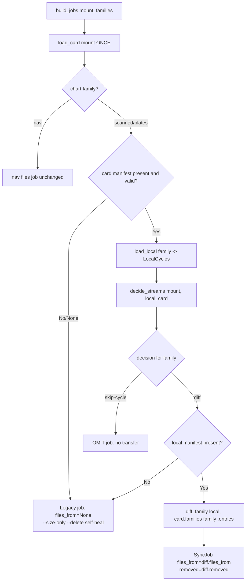
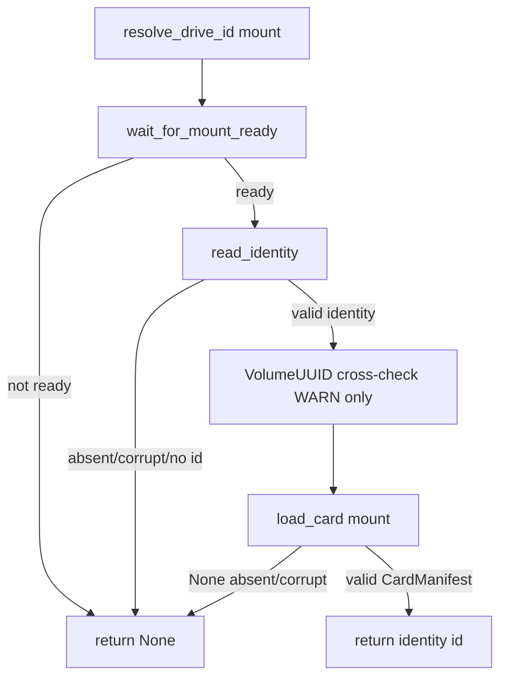
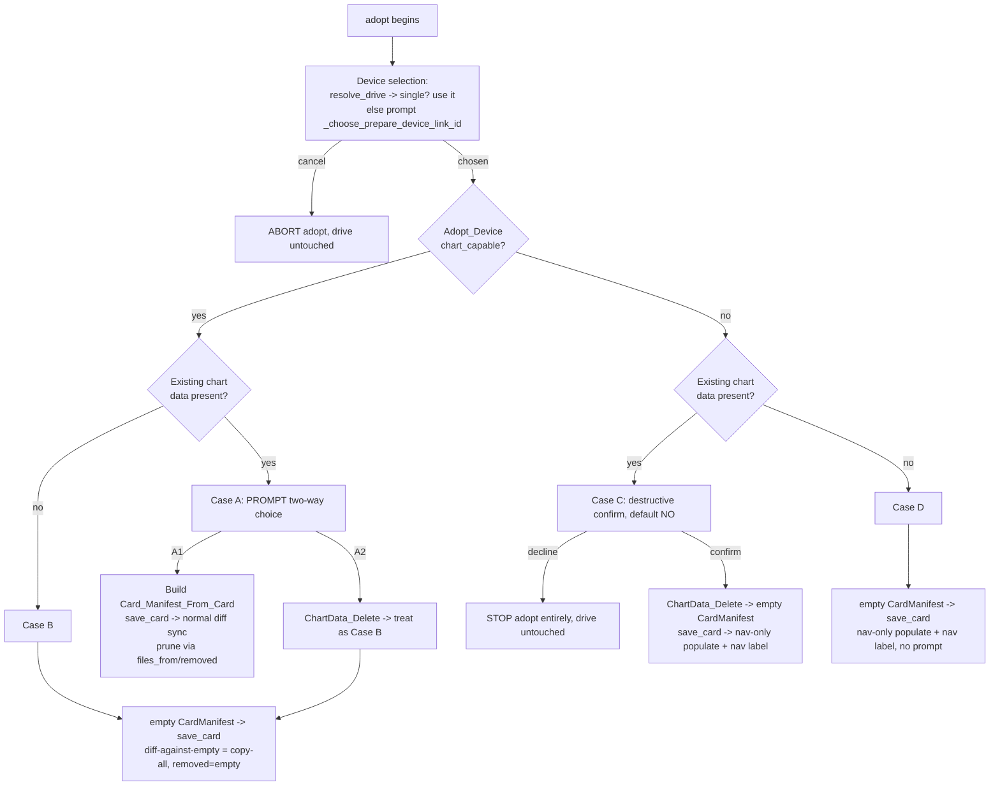

# Design Document

## Overview

This design finishes wiring the already-built SHA-256 manifest engine into the
live sync and removes the false-aborting stall detector. All the engine pieces
already exist and are unit-tested — `manifest.Manifest_Builder`,
`manifest.Manifest_Store`, `manifest.diff_family` / `ManifestDiff`,
`drive_updater.decide_streams` / `LocalCycles` / `StreamDecision`, and
`SyncJob.files_from` / `SyncJob.removed`, which `sync_payload` already honors in
its `--files-from=-` branch. The defect is that `build_jobs` never populates
`files_from`, so `decide_streams` and `diff_family` have **zero production
callers** and every sync (including verify+repair) falls through to the legacy
`rsync --size-only --delete` whole-tree path over ~102,000 files. The second
defect is that `sync_payload`'s dual-signal stall watchdog
(`STALL_TIMEOUT_SECONDS = 120`) false-aborts a healthy sync during the long
silent receiver-side file-list / `--delete` scan.

The work touches six source modules and is deliberately surgical:

| Module | Change |
| --- | --- |
| `drive_updater.py` | Remove stall machinery; wire the diff into `build_jobs`; gate `resolve_drive_id` on both files; write initial manifest at prepare/adopt; change identity schema; nav-aware relabel. |
| `manifest.py` | No code change (the store/diff are reused as-is). |
| `labels.py` | Add `build_nav_volume_label`. |
| `app.py` | Thread `chart_capable` + `nav_label_prefix` into prepare/adopt. |
| `currency.py` | No code change (manifest build + `nav_db_valid_date` reused as-is). |
| `repro_harness.py` | Sever the `stall_hook` wiring so it still imports + self-tests. |

Per the project versioning policy, `MENUBAR_VERSION` is bumped at release
(see the closing note). No new runtime dependencies are introduced.

### Research notes (from reading the current source)

- `sync_payload` already supports two modes keyed on `job.files_from is not
  None`: the manifest-driven `rsync -r --ignore-times --files-from=-` transfer
  (with explicit `_prune_removed`) and the legacy `--size-only --delete`
  whole-tree path. Only the *population* of `files_from` is missing.
- `decide_streams(mount_point, local: LocalCycles, card)` already returns a list
  of `StreamDecision` with `action` in `{"skip-cycle", "diff", "evaluate"}` and
  already handles `card is None` by forcing every chart family to `"diff"`. It
  is pure except for a best-effort `_cross_check_label` WARN (R10.3 is already
  implemented inside it).
- `Manifest_Store.load_card(mount_point)` returns `None` for a missing/corrupt
  manifest; `load_local(family)` returns `None` likewise. Both never raise.
- `currency._build_family_manifest` roots the **scanned** manifest at
  `ChartData/` and prunes the `Plates/` subtree, and roots the **plates**
  manifest at `ChartData/Plates/`. `build_jobs`'s payload roots are
  `ChartData/` (scanned) and `ChartData/Plates/` (plates). The relpath keys and
  the `--files-from` roots therefore already line up — no remapping needed.
- `resolve_drive_id` currently returns the identity `id` after a VolumeUUID
  cross-check; it does **not** read the card manifest.
- `_new_identity` writes a `label` field that **no production code reads** (a
  codebase grep found only `_new_identity` writing it; `resolve_drive_id` reads
  `volume_uuid`, not `label`). It is safe to drop.
- At prepare time the chosen device Link_ID is known on the main thread
  (`_choose_prepare_device_link_id`) and `config.configured_device(config,
  link_id)` yields `{"link_id", "friendly_name", "chart_capable"}` — the source
  for the identity `chart_capable` snapshot and the nav label prefix.
- `_current_data_cycle()` already reads `currency._load_grt_metadata()[
  "nav_db_valid_date"]` (e.g. `"10/29/2026"`), the same source R9 names for MMDD.

## Architecture

The sync pipeline is unchanged in shape; this feature changes **what
`build_jobs` emits** and **where recognition and provisioning write/read the
card manifest**. The runtime flow after this change:

```
app._run_drive_update
  -> resolve_drive_id(mount)            # NOW requires identity AND card manifest
  -> check_drive_currency / update_drive
       -> build_jobs(mount, families)   # NOW computes the manifest diff per chart family
            -> Manifest_Store.load_card(mount)       (once)
            -> per chart family: load_local, decide_streams, diff_family
            -> SyncJob(files_from=..., removed=...)  OR  omit (skip-cycle)  OR  legacy (files_from=None)
       -> run_sync_job -> sync_payload  # already honors files_from
       -> _relabel_from_card_manifest   # NOW nav-aware via identity chart_capable
```

### build_jobs decision flow (new)



### Recognition (both-files) flow (new)



## Components and Interfaces

Changes are organized by the seven requirements.

### A. Remove the stall detector (R1)

**Deletions in `drive_updater.py`:**

- The `STALL_TIMEOUT_SECONDS = 120` constant and its ~20-line comment block
  (around lines 49-66).
- `_proc_cpu_seconds(pid)` (around lines 95-122).
- `_parse_ps_time(raw)` (around lines 149-167).
- The `stall_hook` parameter from `sync_payload`'s signature and its docstring
  paragraph (around lines 944, 1006-1026).
- The poll-loop stall machinery: `stalled`, `last_cpu`, `last_progress`,
  `last_size`, the `cur_size` / `cur_cpu` / `stdout_grew` / `cpu_advanced`
  computation, the `elif STALL_TIMEOUT_SECONDS ...` stall branch with its
  `stall_hook(...)` call, and the post-loop `if stalled:` error block (around
  lines 1163-1211 and 1233-1241).

**Reduced poll loop.** After removal, the loop performs ONLY the two actions
R1.3 permits — the abort check and temp-file-backed `proc.wait()`:

```python
aborted = False
while proc.poll() is None:
    if is_aborted is not None and is_aborted():
        aborted = True
        _terminate(proc)
        break
    try:
        proc.wait(timeout=1)
    except subprocess.TimeoutExpired:
        continue
```

The temp-file stdout/stderr draining (the `NamedTemporaryFile` redirection that
is the real anti-deadlock fix) stays. The `aborted` handling, file-count
parsing, non-zero-exit error capture, and `_prune_removed` call are unchanged.

**`_is_progress2_noise` — KEEP.** It is still called in the file-count parse
loop to filter `--out-format` fragments that are not filenames. It is not part
of the stall detector and has a live caller, so removing it would break the
count. Leave it in place.

**Imports — no change needed (verified against source).** The stall-hook
`onset_wall` used `datetime.now(timezone.utc)`, but removing it does NOT free
either name: `_now_iso()` (drive_updater.py line 238) independently uses
`datetime.now(timezone.utc).astimezone().isoformat()`, so BOTH `datetime` and
`timezone` remain live. Likewise the `time` module stays imported — the poll
loop's `time.monotonic()` calls go away, but `prepare_drive`'s format heartbeat
(`time.monotonic()` / `time.sleep(1)`) still uses it. Leave
`from datetime import datetime, timezone` and `import time` as-is. (An earlier
draft of this design claimed `timezone` becomes unused; that was wrong — the
`_now_iso` use was overlooked.)

**`repro_harness.py` — sever the `stall_hook` wiring.** Its
`run_acceptance` builds `_sync_payload_with_hook(job, is_aborted=None,
stall_hook=None)` and calls `original_sync_payload(job, is_aborted=...,
stall_hook=_chained)`. Since `sync_payload` no longer accepts `stall_hook`:
remove the `make_stall_hook` wiring, the `_sync_payload_with_hook` wrapper, and
the monkeypatch of `drive_updater.sync_payload`; call `update_drive` /
`verify_drive` directly. The stall-observation step becomes a no-op (the
watchdog it observed is gone): `_detect_stall` returns `(False, "stall
detector removed")` and the gate's `no_stall` is always True. `ProgressSampler`,
`compute_throughput`, `evaluate_gate`, and the report formatting stay. The
module must still import cleanly and pass `--self-test` (R1.6).

**Untouched (R10.4).** `MountWatchdog`, its `is_aborted` predicate, the
`run_sync_job_watched` wiring, the sleep at-risk flag, and the `aborted` branch
in `sync_payload` are the sole liveness mechanism and are not modified.

### B. Wire the manifest diff into `build_jobs` (R2)

`build_jobs(mount_point, families)` gains manifest knowledge. A small helper
computes the per-chart-family plan so `build_jobs` stays readable and
`verify_drive` reuses the identical wiring.

```python
# scanned's cycle is charts_cycle; plates' cycle is plates_cycle.
def _chart_family_job(name, mount_point, local_root, card):
    """Return a SyncJob for a chart family, or None to omit it (skip-cycle)."""
    from . import manifest as _manifest

    base = _legacy_tree_job(name, mount_point, local_root)  # files_from=None

    if card is None:
        return base  # absent/corrupt card manifest -> legacy --delete self-heal (R2.3)

    local_fam = _manifest.Manifest_Store.load_local(name)
    if local_fam is None:
        return base  # no local manifest -> cannot diff -> legacy (fallback, below)

    cycles = LocalCycles(
        charts_cycle=(local_fam.cycle if name == "scanned" else None),
        plates_cycle=(local_fam.cycle if name == "plates" else None),
    )
    decisions = {d.family: d for d in decide_streams(mount_point, cycles, card)}
    action = decisions[name].action
    if action == "skip-cycle":
        return None  # OMIT the job entirely (R2.2)

    card_entries = (card.families.get(name).entries
                    if name in card.families else {})
    diff = _manifest.diff_family(local_fam, card_entries)
    base.files_from = list(diff.files_from)
    base.removed = list(diff.removed)
    return base
```

`build_jobs` loads the card manifest **once** and passes it to each chart
family (no per-family `load_card`), then filters out `None` results:

```python
card = _manifest.Manifest_Store.load_card(mount_point)  # once, tolerant
jobs = []
for name in requested:
    if name == "nav":
        jobs.append(_nav_files_job())          # unchanged (R2.5)
    else:
        job = _chart_family_job(name, mount_point, local_root, card)
        if job is not None:                    # skip-cycle omits
            jobs.append(job)
return jobs
```

Addressing the enumerated points:

1. **Relpath-root consistency (R2.4).** No remapping is needed. `currency.
   _build_family_manifest` keys the scanned manifest relative to `ChartData/`
   (with `Plates/` pruned) and the plates manifest relative to
   `ChartData/Plates/`. `build_jobs`'s existing `payload_root_local` /
   `payload_root_drive` are `ChartData/` and `ChartData/Plates/` (via
   `_tree_root`), which `sync_payload` feeds as the `--files-from` roots. The
   diff relpaths are therefore already interpreted relative to the correct
   family root. The design keeps `base = _legacy_tree_job(...)` (the existing
   scanned/plates `SyncJob` builder) so payload roots, excludes, and markers are
   identical between legacy and manifest-driven modes.
2. **Local manifest missing but card present.** We cannot compute a diff
   without a local manifest (`load_local` is the only source of the new content
   hashes). Fall back to a **legacy job** (`files_from=None`) so the
   `--size-only --delete` reconcile still converges. This is the `local_fam is
   None` branch above. It is strictly safer than an empty diff (which would
   prune nothing).
3. **`decide_streams` assembly without duplicate `load_card`.** `build_jobs`
   loads the card once and passes it in; `LocalCycles` is assembled from the
   per-family `load_local(...).cycle`. Because `decide_streams` evaluates all
   three streams from one `card`, and `build_jobs` calls `_chart_family_job`
   per family, the helper takes the already-loaded `card` and reads only its
   own family's decision from the returned list. (A micro-optimization to call
   `decide_streams` once in `build_jobs` and pass the decision down is possible
   but not required; correctness is identical.)
4. **`verify_drive` reuse + repair correctness.** `verify_drive` already calls
   `build_jobs`, so it inherits the manifest wiring automatically — a verify
   builds the same diff-aware jobs. **However**, a repair is triggered precisely
   because `verify_family` found a count/size discrepancy, i.e. the on-card
   state disagrees with what the card manifest claims. Trusting the card
   manifest's diff in that state would transfer only the (stale-manifest) delta
   and could leave the discrepancy unresolved. **Recommendation:** during a
   repair, force the discrepant family to a **legacy full job** (`files_from =
   None`) so the `--size-only --delete` reconcile re-converges the whole family
   tree, then the family's card manifest is rewritten by the normal
   `_write_card_manifest_for_family` step. Concretely, in `verify_drive`'s
   `repair` branch, re-run the family via a legacy job rather than the diff
   job built by `build_jobs` (e.g. `jobs_by_name[name]` with `files_from`
   cleared, or rebuild that one job with a sentinel that forces legacy). Verify
   (the read path) uses the diff-aware jobs only for the discrepancy report;
   repair (the write path) uses legacy-full for correctness.
5. **Nav job unchanged (R2.5).** `nav` stays a `kind == "files"` job with
   `files = ["NAV.DB", "NAV-proc.DB"]`, `files_from = None`, `removed = None`,
   no manifest, no cycle gate.

### C. Recognition requires both files (R3)

Add a card-manifest gate to `resolve_drive_id`, **after** the identity parse +
VolumeUUID cross-check and **before** returning the id:

```python
    drive_id = identity.get("id")
    if drive_id:
        # R3.3: recognition requires BOTH files. A drive with identity but no
        # valid card manifest is not fully provisioned -> route to Prepare/Adopt.
        from . import manifest as _manifest
        if _manifest.Manifest_Store.load_card(mount_point) is None:
            logger.warning(
                "resolve_drive_id: %s has identity but no valid card manifest; "
                "treating as unmanaged (re-Adopt required).", mount_point,
            )
            return None
        return drive_id
```

- Interaction with `wait_for_mount_ready`: unchanged — the readiness race still
  runs first; the manifest read only happens once the mount is ready and the
  identity is valid.
- Interaction with the VolumeUUID cross-check: unchanged — the WARN-only
  mismatch check stays; the manifest gate is an additional AND condition.
- Behavior change (intended): a drive that has identity but no manifest becomes
  unrecognized until re-Adopted. R4 (prepare) and R7.4 (adopt) guarantee a valid
  card manifest exists after provisioning, so newly provisioned drives satisfy
  the rule immediately. The user's current test card (identity-only, pre-fix)
  will be re-Adopted once.

### D. Prepare and Adopt provisioning (R4, R5, R6, R7)

This section is split into two halves: **Prepare** (simple, blank-volume
first-populate, R4) and **Adopt** (device selection + content matrix, R5/R6/R7).
The earlier "Recommended vs Alternative first-populate" open question is now
**closed** — adopt no longer leans on a reorder-or-flag trick to prune orphans.
Instead adopt builds a **truthful** card manifest up front (from the card, or
empty after a scoped delete), and the normal diff sync does the right thing.

#### D.1 Prepare writes an empty initial Card_Manifest (R4)

`prepare_drive` writes a valid empty `CardManifest()` via
`Manifest_Store.save_card` **before** its first populate `update_drive`,
alongside `_ensure_identity`.

Initial manifest shape (R4.2): `charts_cycle=None`, `plates_cycle=None`,
`families={}`, with `written` stamped and the standard `kind`/`schema_version`.
This is exactly `manifest.CardManifest()` (its dataclass defaults).

Placement: after the remount wait, `GRTCHARTS` creation, Spotlight marker/label,
and `_ensure_identity(...)` / provenance stamp, and **before** the
`"Populating drive with current data..."` `update_drive` call.

```python
    from . import manifest as _manifest
    try:
        _manifest.Manifest_Store.save_card(mount_point, _manifest.CardManifest())
    except Exception as e:  # best-effort; see Error Handling
        logger.warning("Could not write initial card manifest to %s: %s",
                       mount_point, e)
```

Why this is correct for prepare: a freshly-formatted FAT volume has **no**
pre-existing chart files, so the first populate diffs each chart family against
the empty manifest => `files_from = all local files`, `removed = []`. Copy-all
with nothing to prune. Fast and correct (R4.4). Because both the identity and
the empty manifest exist before the populate, `resolve_drive_id` recognizes the
drive immediately (R4.3). Prepare's device binding (`device_link_id`,
`chart_capable`, `nav_label_prefix`) is unchanged from multi-device-settings and
feeds the identity-schema fields in Section E.

#### D.2 Adopt device selection (R5)

Adopt now mirrors Prepare's device-selection step. The goal: determine **which
configured device** the drive is being adopted for, because that device's
`chart_capable` flag and friendly name drive both the content matrix (D.3) and
the identity labeling fields (Section E).

Resolution order (R5.1–R5.4):

1. **Resolve from the drive's own `Settings.bak`.** Reuse the existing
   `app._find_drive_settings(mount_point)` + `read_identity(mount_point)` +
   `device_resolution.resolve_drive(parsed, recorded_identity, config)` path —
   exactly what `app._device_chart_capable` and the mount hook already use
   (Link_ID SID 387 -> configured device -> `chart_capable` + `friendly_name`).
2. **Unambiguous single device => use it, no prompt** (R5.2).
3. **No/foreign `Settings.bak`, or ambiguous => prompt**, reusing the Prepare
   prompt `_choose_prepare_device_link_id` (R5.3). **Cancelling the prompt
   aborts the adopt**, same as Prepare (R5.4). No files on the drive are touched
   when the user cancels.

**Where device selection happens (R5.6).** On the **main thread**, inside the
`@rumps.clicked` adopt handler, **before** the background `_do_adopt_drive`
worker starts — identical to how `prepare_drive` resolves `chosen_link_id` via
`_choose_prepare_device_link_id()` on the main thread and threads it into
`_do_prepare_drive`. rumps prompts must never be raised from the worker thread.

```python
# app._do_... caller (main thread), mirroring the prepare device-binding block:
link_id = self._resolve_adopt_device_link_id(volume_path)   # resolve-then-prompt
if link_id is None:
    return                      # user cancelled the device prompt -> abort adopt
device = configured_device(load_config(), link_id) or {}
chart_capable = bool(device.get("chart_capable", True))     # fail-safe True
nav_label_prefix = labels._sanitize_label(device.get("friendly_name") or "")
# content-handling decision (D.3) is also made on the main thread so its
# prompts (A choice / C destructive confirm) run on the main thread, then the
# resolved plan is threaded into the worker.
```

`_resolve_adopt_device_link_id` first tries `resolve_drive`; if that returns a
single `RESOLVED` device it returns its `link_id` with no prompt, otherwise it
delegates to `_choose_prepare_device_link_id()` (returning `None` on cancel).

The chosen device yields `chart_capable` (bool) and the friendly name (for
`nav_label_prefix`); both are written into the identity (R5.5, and Section E).

#### D.3 Adopt content-handling matrix (R6)

After the device is chosen, adopt branches on two facts: the Adopt_Device's
`chart_capable` flag, and whether **Existing_Chart_Data** is present (a non-empty
`ChartData/` tree physically on the card). This yields four cases:



**Case A — chart-capable, Existing_Chart_Data present (R6.1–R6.5, R6.11).**
PROMPT a two-way choice (both options proceed; there is no abort here):

- **A1 — build the manifest from the card.** Run `Manifest_Builder.build` over
  the card's `ChartData/` to produce a truthful `Card_Manifest_From_Card`, then
  `save_card` it, then run the normal diff `update_drive`. Because the saved
  manifest now records exactly what is physically on the card, the normal diff
  sync updates to the current local cycle and prunes orphans through the standard
  `--files-from` + `_prune_removed` path (R6.3). **Cost:** SHA-256 hashing
  ~100,000 small files on a slow USB card is a multi-minute operation; surface a
  progress callback (R6.5), reusing the same `progress_callback(msg)` channel the
  rest of adopt uses.
- **A2 — delete then fresh.** Perform a `ChartData_Delete` (D.4), then fall
  through to **Case B** (empty manifest -> diff-against-empty -> full fresh copy
  of the current cycle) (R6.4).

**Building `Card_Manifest_From_Card` (A1) precisely (R6.11).** Reuse the same
family-root rules `currency._build_family_manifest` uses so the card-derived
manifest matches what the sync jobs transfer:

```python
def _card_manifest_from_card(mount_point, progress_callback=None):
    """Build a truthful CardManifest from the card's own ChartData/ tree.

    scanned: Manifest_Builder.build("scanned", <ChartData/>, cycle=None) with the
             Plates/ subtree pruned (same prune currency._build_family_manifest
             applies), so scanned excludes Plates/.
    plates:  Manifest_Builder.build("plates", <ChartData/Plates/>, cycle=None).
    Cycles are null (see below). Hashing is the expensive step -> progress.
    """
    chart_root = os.path.join(mount_point, "ChartData")
    scanned = Manifest_Builder.build("scanned", chart_root, cycle=None)
    scanned.entries = {rel: e for rel, e in scanned.entries.items()
                       if not (rel == "Plates" or rel.startswith("Plates/"))}
    plates_root = os.path.join(chart_root, "Plates")
    plates = Manifest_Builder.build("plates", plates_root, cycle=None)
    return CardManifest(charts_cycle=None, plates_cycle=None,
                        families={"scanned": scanned, "plates": plates})
```

**The A1 cycle question — pinned down (R6.11).** When building the manifest from
the card, the per-family cycle is **unknown**: the card carries no cycle stamp we
can trust. Confirmed earlier in this design's research — neither
`EFIS_DRIVE_ID.json` nor the `ScannedCharts.sqlite` / `Plates.sqlite` markers
encode a reliable chart cycle. Therefore the card-derived `CardManifest` sets
`charts_cycle` and `plates_cycle` to **null**. This is the correct, safe choice:
with null recorded cycles, `decide_streams` cannot `skip-cycle`, so the first
diff sync transfers the delta from the card's current content up to the current
**local** cycle, and `_write_card_manifest_for_family` stamps the real cycle on
completion. The truthful per-file entries (not the cycle) are what make the diff
prune orphans correctly; the cycle number is re-established by the first sync.

**Case B — chart-capable, no Existing_Chart_Data (R6.6).** Write an empty
`CardManifest()`, `save_card`, then normal populate: diff-against-empty =>
`files_from = all local files`, `removed = []` (a blank volume has no orphans).
Fast and correct. (Case A2 funnels here after the delete.)

**Case C — non-chart-capable, Existing_Chart_Data present (R6.7–R6.9).** A
nav-only device must not carry charts. Show a **blocking destructive
confirmation defaulting to No** (reuse the rumps `alert(..., ok=..., cancel=...)`
pattern prepare already uses for its destructive confirmations):

- **Declines (R6.8):** inform the user and **STOP the adoption entirely** —
  abandon the adopt as a whole, leaving the drive unmodified. We must not leave a
  contradictory nav-identity-with-charts drive, so we do not write identity or
  manifest in this path.
- **Confirms (R6.9):** `ChartData_Delete` (D.4), write an empty `CardManifest()`,
  `save_card`, then a **nav-only** populate (`update_drive` with chart families
  withheld, as the sync gate already does for non-chart-capable devices) and a
  nav-only label (Section F).

**Case D — non-chart-capable, no Existing_Chart_Data (R6.10).** Write an empty
`CardManifest()`, `save_card`, nav-only populate + nav-only label. No prompt.

**Threading into `adopt_drive` (R5.5, R6).** The main-thread handler resolves the
device, makes the content-handling decision (raising the A choice / C confirm
prompts on the main thread), and threads the resolved plan into the worker. The
`adopt_drive` signature gains:

```python
def adopt_drive(
    mount_point: str,
    *,
    chart_capable: bool,
    nav_label_prefix: str,
    content_action: str,       # "manifest_from_card" | "delete_then_fresh"
                               #  | "fresh" | "nav_only_delete" | "nav_only"
    progress_callback: Optional[Callable] = None,
) -> dict:
```

- Case A1 => `content_action="manifest_from_card"`.
- Case A2 => `content_action="delete_then_fresh"` (delete, then behaves as fresh).
- Case B => `content_action="fresh"`.
- Case C confirmed => `content_action="nav_only_delete"`.
- Case D => `content_action="nav_only"`.
- Case C declined / device prompt cancelled => the worker is **never started**.

`adopt_drive` then: writes identity with `chart_capable` + `nav_label_prefix`;
performs the delete when the action calls for it; writes the appropriate card
manifest (from-card for A1, empty otherwise) via `save_card`; and calls
`update_drive` (full families for chart-capable, nav-only for C/D).

#### D.4 The scoped delete helper (R7.1–R7.3)

A single helper performs the `ChartData_Delete`, reused by Case A2 and Case C:

```python
def _delete_chart_data_tree(mount_point: str) -> None:
    """Remove ONLY the card's ChartData/ tree (scanned payload, Plates/ payload,
    and the ScannedCharts.sqlite / Plates.sqlite markers within it).

    LEAVES UNTOUCHED: NAV.DB, NAV-proc.DB, EFIS_DRIVE_ID.json, EFIS_MANIFEST.json,
    GRTCHARTS/, and all root-level settings / flight-data / backup files
    (Settings.dat, Plan.dat, State.dat, WP.dat, *.bak, ...). This is a targeted
    ChartData/ removal, NOT a format and NOT a root-level wipe (R7.1-R7.3).
    """
    chart_root = os.path.join(mount_point, "ChartData")
    if os.path.isdir(chart_root):
        shutil.rmtree(chart_root, ignore_errors=False)
```

Because `ScannedCharts.sqlite`, `Plates.sqlite`, and `Plates/` all live **inside**
`ChartData/`, a single `rmtree` of `ChartData/` removes exactly the chart payload
and its markers and nothing else. Everything at the volume root — nav DBs,
identity, the manifest we are about to (re)write, `GRTCHARTS/`, and every
settings/flight-data/backup file — is physically outside `ChartData/` and is not
touched. This delete is an **explicit, user-confirmed adopt action**, distinct
from the sync's family `--delete`; R10.5 (sync never deletes root flight data)
stays intact, and R10.6 records that the adopt delete is scoped to `ChartData/`
only.

#### D.5 Post-adopt recognition (R7.4)

After any successful adopt (Case A, B, C-confirmed, or D), both the Identity_File
and a valid Card_Manifest exist at the volume root:

- A1 saves the from-card manifest before the sync; the sync then rewrites real
  per-family manifests with stamped cycles via `_write_card_manifest_for_family`.
- A2/B/C-confirmed/D each `save_card` an empty `CardManifest()` before the
  populate; the populate's converged chart families (B, A2) rewrite real
  per-family manifests, and the nav-only paths (C, D) keep the empty manifest.

So `resolve_drive_id` returns the drive's `id` immediately after adopt in every
non-aborted case (R7.4). The identity is written with the resolved
`chart_capable` + `nav_label_prefix` so the post-sync relabel (Section F) picks
the correct `C<charts>P<plates>` vs `<PREFIX><MMDD>` form.

### E. Identity schema changes (R8)

**Drop `label` (R8.1, R8.2).** Remove the `"label": label` entry from
`_new_identity`'s returned dict and the `label` parameter plumbing where it is
only used to populate that field. A codebase grep confirms **no production
reader** of `identity["label"]`, so no consumer update is required beyond the
tests (see Testing Strategy). Keep the uuid4 `id` (R8.3) and do **not** add any
cycle numbers (R8.4 — cycles live only in the card manifest).

**Add `chart_capable` (R8.5, R8.7).** A boolean written at prepare/adopt for
**labeling only** (it never gates which families sync — that stays
`app._device_chart_capable` from config, R9.1/R8.7).

Source + threading of the value at prepare/adopt time:

- At prepare, the chosen device Link_ID is resolved on the main thread
  (`_choose_prepare_device_link_id`). `config.configured_device(config,
  link_id)` yields the device dict with `chart_capable` and `friendly_name`.
- Thread both values from `app._do_prepare_drive` into `prepare_drive(...,
  chart_capable=..., nav_label_prefix=...)`. For **adopt**, the main-thread
  handler resolves the Adopt_Device (Section D.2) and threads `chart_capable`
  and `nav_label_prefix` into `adopt_drive(..., chart_capable=...,
  nav_label_prefix=..., content_action=...)` — the same two values, now sourced
  from the Adopt_Device resolution rather than recomputed inside the worker
  (R5.5). This keeps `chart_capable` consistent between the content matrix
  (Section D.3) and the identity write.
- `prepare_drive` / `adopt_drive` pass these into `_ensure_identity(mount_point,
  chart_capable=..., nav_label_prefix=...)`, which passes them to
  `_new_identity(...)` so the fresh identity carries them. (When an identity
  already exists on a re-prepare, merge the fields via
  `update_identity_provenance`.)

**Refresh `chart_capable` on sync (R8.6).** Merge it into the identity at the
end of a managed sync. The cleanest seam is `update_drive`: after the jobs run
and before `_relabel_from_card_manifest`, call
`_safe_update_provenance(mount_point, chart_capable=<resolved>)`. Because
`update_drive` does not itself know the capability (it is config-derived in
`app`), the app passes the resolved boolean into `update_drive` (new optional
kwarg, defaulting to leave-unchanged), or `update_drive` reads the existing
identity's `chart_capable` and re-affirms it. Recommendation: `app._run_drive_
update` computes `_device_chart_capable(mount_point)` (it already does) and
passes it to `update_drive(..., chart_capable=...)`, which forwards it to a
single `_safe_update_provenance` merge. Provenance merges never raise into the
sync path (`_safe_update_provenance` guarantee).

**Add `nav_label_prefix` (supports R9.7).** Stored in identity at prepare/adopt
so the relabel step can build the nav label without reading the aircraft config.
Value = the sanitized friendly-name prefix (see F). Storing a stable
`nav_label_prefix` (rather than the raw friendly name) keeps the relabel
self-contained and FAT-safe.

### F. Capability authority and post-sync relabeling (R9)

**`labels.build_nav_volume_label` (new).**

```python
def build_nav_volume_label(friendly_name: Optional[str],
                           nav_valid_date: Optional[str]) -> str:
    """Build '<PREFIX><MMDD>' for a non-chart-capable (nav-only) drive.

    PREFIX = _sanitize_label(friendly_name); fallback 'EFISNAV' when the
    friendly name is blank/sanitizes empty, further reduced to 'NAV' when the
    MMDD would push the label past 11 chars. MMDD = month+day of nav_valid_date
    (parsed from the GRT 'MM/DD/YYYY' form, e.g. '10/29/2026' -> '1029').
    Result is sanitized ([A-Z0-9], <=11) and contains NO year (R9.5, R9.6).
    """
```

Behavior:
- Parse `nav_valid_date` with the GRT format (`MM/DD/YYYY`); derive `MMDD`
  (zero-padded month+day). If unparseable, `MMDD` is empty and the label is just
  the prefix (still sanitized/truncated).
- `PREFIX = _sanitize_label(friendly_name)`. If empty, use `"EFISNAV"`. Compute
  `PREFIX + MMDD`; if that exceeds `_LABEL_MAX_LEN` (11) and the prefix was the
  `EFISNAV` fallback, reduce to `"NAV"` (so `NAV1029` fits). For a user prefix
  that is too long, `_sanitize_label` truncation on the final concatenation
  keeps it <=11 (R9.4, R9.6).
- Reuse `_sanitize_label`, `_LABEL_MAX_LEN`, `_LABEL_ALLOWED_RE` already in
  `labels.py`.
- Example: friendly name `"Mini A/P"`, nav date `"10/29/2026"` ->
  `_sanitize_label("MINIAP") + "1029"` = `"MINIAP1029"` (10 chars, <=11).

**`_relabel_from_card_manifest` (change).** It currently reads the card manifest
and always builds `C<charts>P<plates>` via `build_volume_label`. New behavior:

```python
    identity = read_identity(mount_point) or {}
    chart_capable = identity.get("chart_capable", True)   # fail-safe: chart-capable

    if chart_capable:
        # existing path: mirror card manifest cycles into C<charts>P<plates>
        ... (unchanged: load_card, skip if no cycles, build_volume_label, _rename_volume)
    else:
        # nav-only drive: <PREFIX><MMDD>, no aircraft-config read (R9.7)
        prefix = identity.get("nav_label_prefix")        # stored at prepare/adopt
        nav_valid_date = _current_data_cycle()           # GRT nav_db_valid_date
        label = labels.build_nav_volume_label(prefix, nav_valid_date)
        if label:
            _rename_volume(mount_point, label)
```

Reconciling R9.7 (relabel must NOT read the aircraft config) with the nav label
needing a friendly-name prefix: the prefix is read from the **identity file**
(`nav_label_prefix`, written at prepare/adopt from the config at that time), and
the MMDD comes from `_current_data_cycle()` (the GRT metadata, not the aircraft
config). So the relabel step reads only the identity file + GRT metadata — never
the aircraft config — satisfying R9.7.

- `chart_capable` is read from the identity (R9.7). `chart_capable=True` (or
  missing) keeps the existing `C<charts>P<plates>` behavior (R9.2); `False`
  takes the nav path (R9.3).
- The label stays a best-effort mirror: a missing identity, missing prefix,
  unparseable date, or rename failure is logged, never fatal (R10.3-adjacent;
  `_rename_volume` already never raises).

**Sync gate unchanged (R9.1).** `app._device_chart_capable` (config + Link_ID,
fail-safe to chart-capable, config authoritative) still decides which families
sync. This feature does not touch it.

## Data Models

### Identity_File (`EFIS_DRIVE_ID.json`) — new shape

Dropped: `label`. Added: `chart_capable`, `nav_label_prefix`. Cycles are NOT
stored (R8.4). `id` stays uuid4 (R8.3).

```jsonc
{
  "schema_version": 2,
  "id": "a1b2c3d4-...",            // uuid4, durable (unchanged)
  "kind": "efis-chart-drive",
  "volume_uuid": "XXXX-XXXX",
  "chart_capable": true,            // NEW: labeling snapshot only (R8.5-R8.7)
  "nav_label_prefix": "MINIAP",     // NEW: sanitized prefix for nav label (R9.7)
  "created": "2026-...",
  "prepared_by": "EFISDataManager ... on host",
  "device_link_id": "1",
  "last_sync_started": null,
  "last_sync_completed": null,
  "last_sync_result": null,
  "last_sync_families": [],
  "sync_count": 0,
  "data_cycle": null
  // NOTE: no "label" field anymore
}
```

Backward read: existing drives lack `chart_capable` / `nav_label_prefix`;
readers default `chart_capable` to `True` (fail-safe, chart-capable) and treat a
missing `nav_label_prefix` as blank (falls back to `EFISNAV`/`NAV`). Existing
drives still carrying `label` are harmless (no reader).

### Card_Manifest (`EFIS_MANIFEST.json`) — initial shape

The initial manifest written at prepare (R4.2) and at adopt for the empty-manifest
cases (B, A2, C-confirmed, D) is `manifest.CardManifest()` with its dataclass
defaults. (The adopt Case A1 manifest is instead built from the card — see
Section D.3 — with null cycles and real per-file entries.)

```jsonc
{
  "schema_version": 1,
  "kind": "efis-chart-manifest",
  "charts_cycle": null,
  "plates_cycle": null,
  "written": "2026-...",
  "families": {}                    // empty: no per-family entries yet
}
```

No change to the `CardManifest` / `FamilyManifest` / `ManifestEntry` dataclasses
or their JSON round-trip (`card_to_json` / `card_from_json`).

## Correctness Properties

*A property is a characteristic or behavior that should hold true across all
valid executions of a system — essentially, a formal statement about what the
system should do. Properties serve as the bridge between human-readable
specifications and machine-verifiable correctness guarantees.*

Each property below is implemented by a SINGLE property-based test (min 100
iterations) tagged `Feature: chart-sync-wiring-fix, Property N: <text>`.

### Property 1: build_jobs populates the manifest diff

*For any* local family manifest and any valid card manifest with a rolled
cycle, the chart `SyncJob` that `build_jobs` produces for that family has
`files_from` equal to `diff_family(local, card.families[family].entries)
.files_from` and `removed` equal to that diff's `removed` (so `decide_streams`
and `diff_family` are both reached through `build_jobs`).

**Validates: Requirements 2.1, 2.6**

### Property 2: skip-cycle omits the transfer job

*For any* chart family whose local cycle equals the card manifest's recorded
cycle for that family, `build_jobs` returns no `SyncJob` for that family.

**Validates: Requirements 2.2**

### Property 3: absent card manifest yields a legacy job

*For any* requested subset of families, when `load_card` returns `None` (absent
or corrupt manifest), every chart `SyncJob` that `build_jobs` returns has
`files_from is None`.

**Validates: Requirements 2.3**

### Property 4: diff relpaths align with family payload roots

*For any* built chart family manifest, every relpath in the job's `files_from`
and `removed`, joined under the job's `payload_root_drive`, resolves inside that
family's root (scanned under `ChartData/` and never under `Plates/`; plates
under `ChartData/Plates/`), matching the `--files-from` roots `sync_payload`
uses.

**Validates: Requirements 2.4**

### Property 5: chart sync never deletes root-level flight data

*For any* set of root-level flight-data files (`Settings.dat`, `Plan.dat`,
`State.dat`, `WP.dat`, `*.bak`) present at the volume root and any chart-family
`removed` set, running the scanned/plates prune leaves every root-level file
intact, because family deletion is scoped to `ChartData/` and
`ChartData/Plates/`.

**Validates: Requirements 10.5**

### Property 6: nav-only label is well-formed

*For any* device friendly name (including blank / empty-sanitizing) and any
valid `MM/DD/YYYY` nav valid date, `build_nav_volume_label` returns a label that
is `<PREFIX><MMDD>`, at most 11 characters, composed only of `[A-Z0-9]`,
containing the month and day and no year component, using the `EFISNAV`
fallback (reduced to `NAV` when length requires it) when the friendly name
sanitizes empty.

**Validates: Requirements 9.4, 9.5, 9.6**

### Property 7: identity schema invariants

*For any* identity produced by `_new_identity`, the dict contains no `label`
key, contains no chart/plate cycle-number fields, carries a `chart_capable`
boolean, and carries an `id` that parses as a version-4 UUID.

**Validates: Requirements 8.1, 8.3, 8.4**

### Property 8: adopt manifest-from-card build correctness

*For any* `ChartData/` tree on the card (including arbitrary nesting and an
arbitrary `Plates/` subtree), the `Card_Manifest_From_Card` that adopt Case A1
builds has a `scanned` family manifest whose entries equal a fresh
`Manifest_Builder.build("scanned", <ChartData/>)` with the `Plates/` subtree
pruned, a `plates` family manifest whose entries equal a fresh
`Manifest_Builder.build("plates", <ChartData/Plates/>)`, and both
`charts_cycle` and `plates_cycle` equal to null (because the card carries no
trustworthy cycle stamp).

**Validates: Requirements 6.3, 6.11**

### Property 9: adopt ChartData delete scope

*For any* set of files placed under `ChartData/` (including `Plates/` payload
and the `ScannedCharts.sqlite` / `Plates.sqlite` markers) and any set of
non-`ChartData/` paths at the volume root (`NAV.DB`, `NAV-proc.DB`,
`EFIS_DRIVE_ID.json`, `EFIS_MANIFEST.json`, `GRTCHARTS/`, `Settings.dat`,
`Plan.dat`, `State.dat`, `WP.dat`, `*.bak`, and files whose names merely start
with `ChartData`), running `_delete_chart_data_tree` removes the entire
`ChartData/` tree and leaves every non-`ChartData/` path intact (the delete is
neither a format nor a root-level wipe).

**Validates: Requirements 7.1, 7.2, 7.3, 10.6**

## Error Handling

| Condition | Handling |
| --- | --- |
| Local manifest missing for a chart family (`load_local` None) | `build_jobs` falls back to a **legacy job** (`files_from=None`); the `--size-only --delete` reconcile converges. Logged at INFO. Never raises. |
| Card manifest absent/corrupt (`load_card` None) | Treated as not-managed by `resolve_drive_id` (R3.3 -> `None`); treated as first-sync self-heal by `build_jobs` (legacy `--delete`). `load_card` already swallows parse errors and returns `None`. |
| Card manifest present but empty families (prepare, blank volume) | Diff-against-empty => copy-all, no prune. Correct on a blank volume (R4.4). |
| Adopt Case B / A2-after-delete (chart-capable, no/removed data) | Empty card manifest `save_card`ed before populate => diff-against-empty copy-all, `removed=[]`. No orphans to prune (R6.6, R6.4). |
| Adopt Case A1 (chart-capable, existing data, build-from-card) | Truthful card manifest built from the card (`_card_manifest_from_card`, null cycles) `save_card`ed before the normal diff sync; the diff prunes orphans via `--files-from` + `_prune_removed` (R6.3). |
| Adopt device prompt cancelled / Case C declined | The worker is never started and the drive is left fully unmodified — no identity, manifest, or ChartData change (R5.4, R6.8). |
| `_card_manifest_from_card` hashing on slow USB | Multi-minute operation (~100k files); progress surfaced via `progress_callback`. A read error on a single file raises (same as `Manifest_Builder.build`); adopt reports failure rather than recording a file it could not hash (R6.5). |
| `_delete_chart_data_tree` when `ChartData/` absent | No-op (the `isdir` guard); the delete never touches non-`ChartData/` paths (R7.1-R7.3). |
| Initial/empty manifest write fails at prepare/adopt (`save_card` raises) | Best-effort: logged at WARNING, preparation/adoption continues. The drive is still populated; its chart families write real card manifests during the populate, and recognition recovers once a manifest exists. Does NOT fail prepare/adopt. |
| Relabel failure (missing identity, missing prefix, unparseable date, rename error) | Logged, never fatal. `_rename_volume` already returns `False` on failure without raising. The volume label is a mirror, not authoritative (R10.3). |
| Label disagrees with card manifest | `decide_streams` -> `_cross_check_label` already logs a WARNING and the manifest wins (R10.2, R10.3). Unchanged. |
| Abort during sync (drive removed / sleep) | `MountWatchdog` -> `is_aborted()` -> `_terminate(proc)` -> `"aborted"` JobResult, interrupted marker left in place (R10.4). Unchanged by the stall removal. |
| `chart_capable` refresh fails | `_safe_update_provenance` swallows and logs; never raises into the sync path (R8.6 best-effort). |

## Testing Strategy

PBT is appropriate here: the manifest diff, the parsers/serializers, the label
builders, and the `build_jobs` decision mapping are pure functions with
universal properties (round-trip, invariants, metamorphic). The side-effecting
pieces (resolve/recognition gate, prepare/adopt writes, relabel, abort) are
example/integration tests. Property tests run a minimum of 100 iterations and
are tagged `Feature: chart-sync-wiring-fix, Property N: <text>`. Pick the
project's existing property library (Hypothesis — already present, per
`.hypothesis/`).

### Property tests (new/updated)

- **P1 — build_jobs diff wiring.** For any local manifest and card manifest with
  a rolled cycle, `build_jobs` produces a chart `SyncJob` whose `files_from`
  equals `diff_family(local, card_entries).files_from` and whose `removed`
  equals `diff.removed` (reaching `decide_streams`+`diff_family` in production).
- **P2 — skip-cycle omits the job.** For any family whose local cycle equals the
  card's recorded cycle, `build_jobs` returns no job for that family.
- **P3 — absent manifest => legacy job.** For any `families` request, when
  `load_card` returns `None`, every chart job returned has `files_from is None`.
- **P4 — relpath-root alignment.** For any built chart family manifest, every
  `files_from` relpath joined under the job's `payload_root_drive` lands inside
  the correct family root (scanned excludes `Plates/`; plates under
  `ChartData/Plates/`).
- **P5 — root flight data never deleted.** For any set of root-level files
  (`Settings.dat`, `Plan.dat`, `State.dat`, `WP.dat`, `*.bak`) plus any chart
  diff, running the scanned/plates prune/delete leaves every root-level file
  intact (family delete scoped to `ChartData/` and `ChartData/Plates/`).
- **P6 — nav label format + length.** For any friendly name and any valid
  `MM/DD/YYYY` nav date, `build_nav_volume_label` returns a label that is
  `<PREFIX><MMDD>`, <=11 chars, `[A-Z0-9]` only, containing the month+day and no
  year. Includes the blank-name -> `EFISNAV`/`NAV` fallback.
- **P7 — identity schema invariants.** For any prepared/adopted identity, the
  dict has no `label` key, has a boolean `chart_capable`, a uuid4 `id`, and no
  cycle-number fields.
- **P8 — adopt manifest-from-card build correctness.** For any generated
  `ChartData/` tree (with an arbitrary `Plates/` subtree),
  `_card_manifest_from_card` yields a `scanned` manifest equal to a fresh
  `Manifest_Builder.build` of `ChartData/` with `Plates/` pruned, a `plates`
  manifest equal to a fresh build of `ChartData/Plates/`, and null
  `charts_cycle` / `plates_cycle`.
- **P9 — adopt ChartData delete scope.** For any files under `ChartData/` plus
  any non-`ChartData/` paths at the root (nav DBs, identity, manifest,
  `GRTCHARTS/`, settings/flight-data/backups, and `ChartData`-prefixed sibling
  names), `_delete_chart_data_tree` removes the whole `ChartData/` tree and
  leaves every non-`ChartData/` path intact.

### Unit / integration tests (new)

- `resolve_drive_id` returns the id only when BOTH identity and a valid card
  manifest are present; returns `None` when the manifest is absent/corrupt even
  though identity is valid (R3.1-R3.4). Example-based.
- `prepare_drive` writes a valid empty initial card manifest
  (`charts_cycle=None`, `plates_cycle=None`, empty families) before its
  populate, and after the full flow both files are present so `resolve_drive_id`
  recognizes the drive (R4.1-R4.4). Mock diskutil/`save_card` as the convergence
  tests already do.
- **Adopt device selection — resolve-then-prompt (R5.1-R5.4, R5.6).** When
  `resolve_drive` returns a single RESOLVED device, `_resolve_adopt_device_link_id`
  returns that link_id and does NOT call `_choose_prepare_device_link_id`; when
  resolution is unresolved/ambiguous it delegates to the prompt; when the prompt
  returns `None` the adopt is aborted and the drive is left unmodified (no
  identity/manifest/ChartData change). Example-based with patched resolution and
  prompt; filesystem assertion for the cancel case.
- **Adopt content matrix — one example per quadrant (R6.1-R6.11, R7.4).** Case A
  prompt offers the A1/A2 two-way choice (both proceed); A1 builds the from-card
  manifest, `save_card`s it, then the normal diff sync runs; A2 deletes then
  behaves as Case B; Case B writes an empty manifest and copies all; Case C shows
  the destructive confirm; Case D writes an empty manifest and runs nav-only with
  no prompt. After each non-aborted case, both files are present so
  `resolve_drive_id` returns the id (R7.4). Mock the prompts and `update_drive`.
- **Adopt Case C decline aborts (R6.7, R6.8).** When the Case C destructive
  confirmation is declined, the adopt stops entirely: no identity write, no
  manifest write, and the existing `ChartData/` tree is left intact. Example-based
  with a fixture drive and a declined-confirm mock; assert the drive is byte-for-
  byte unmodified.
- **Adopt Case C confirm / A2 delete-scope example (R6.9, R6.4, R7.1-R7.3).** A
  focused example alongside the P9 property: after a confirmed Case C (or A2),
  `ChartData/` is gone and `NAV.DB`, the identity, `GRTCHARTS/`, and root settings
  files remain.
- Verify+repair forces a legacy full reconcile on a discrepant family (point
  B.4), confirming repair transfers the whole family, not a stale diff.
- `_relabel_from_card_manifest` on a chart-capable identity builds
  `C<charts>P<plates>`; on a non-chart-capable identity builds `<PREFIX><MMDD>`
  from the stored `nav_label_prefix` + GRT date, WITHOUT reading the aircraft
  config (R9.2, R9.3, R9.7). Patch `_rename_volume` to capture the label.
- Abort path intact post-removal: with the stall machinery gone, `sync_payload`
  still terminates rsync and returns an aborted result when `is_aborted()` flips
  true (R10.4). Example-based with a fake `Popen`.
- `repro_harness` imports and `--self-test` passes with no `stall_hook`
  reference (R1.6).
- Nav job unchanged: `build_jobs` nav entry has `files_from is None`,
  `removed is None`, `files == ["NAV.DB", "NAV-proc.DB"]` (R2.5, R10.1).

### Dead/affected tests to UPDATE (not delete)

- `tests/test_run_sync_job.py` and `tests/test_sync_payload.py`: remove/rewrite
  the stall-detector tests that monkeypatch `du._proc_cpu_seconds` and
  `du.STALL_TIMEOUT_SECONDS` and assert the stall branch. The abort-path and
  file-count assertions stay. Drop `stall_hook` assertions.
- `tests/test_chart_family_integration.py`: it currently builds the
  `files_from` SyncJob manually and monkeypatches `build_jobs` because the
  wiring did not exist. Now that `build_jobs` wires the diff, **update** these to
  assert the behavior through the real `build_jobs` (the `_patched_build_jobs`
  shim and `_scanned_files_from_job` helper become unnecessary where the real
  path now produces the same job). Keep the end-to-end rsync assertions.
- Any test asserting `identity["label"]` (the `_new_identity` label field):
  update to assert the field is absent and `chart_capable` is present.
- `tests/test_manifest_convergence_property.py`: unchanged (it tests
  `diff_family` convergence directly, which still holds).
- `tests/test_adopt_drive.py`: **expands significantly.** The old adopt tests
  assume a single non-destructive `_ensure_identity` + `update_drive` flow with no
  device selection and no content matrix. They must be rewritten/extended to
  cover: the resolve-then-prompt device selection (and cancel-aborts); each of the
  four content cases (A with its A1/A2 choice, B, C with decline-aborts and
  confirm, D); the new `adopt_drive` keyword signature (`chart_capable`,
  `nav_label_prefix`, `content_action`); the `_card_manifest_from_card` build; and
  the `_delete_chart_data_tree` scope. The new P8/P9 property tests live alongside
  these (property files tagged per the feature/property convention).

## Versioning note

Per the project versioning policy, `MENUBAR_VERSION` in
`src/efis_data_manager/__init__.py` MUST be bumped when this work is released
(it changes live menu-bar sync behavior). `DASHBOARD_VERSION` stays put. The git
tag, `__version__`, and `pyproject.toml` version are handled by the release
step, not by this feature.
