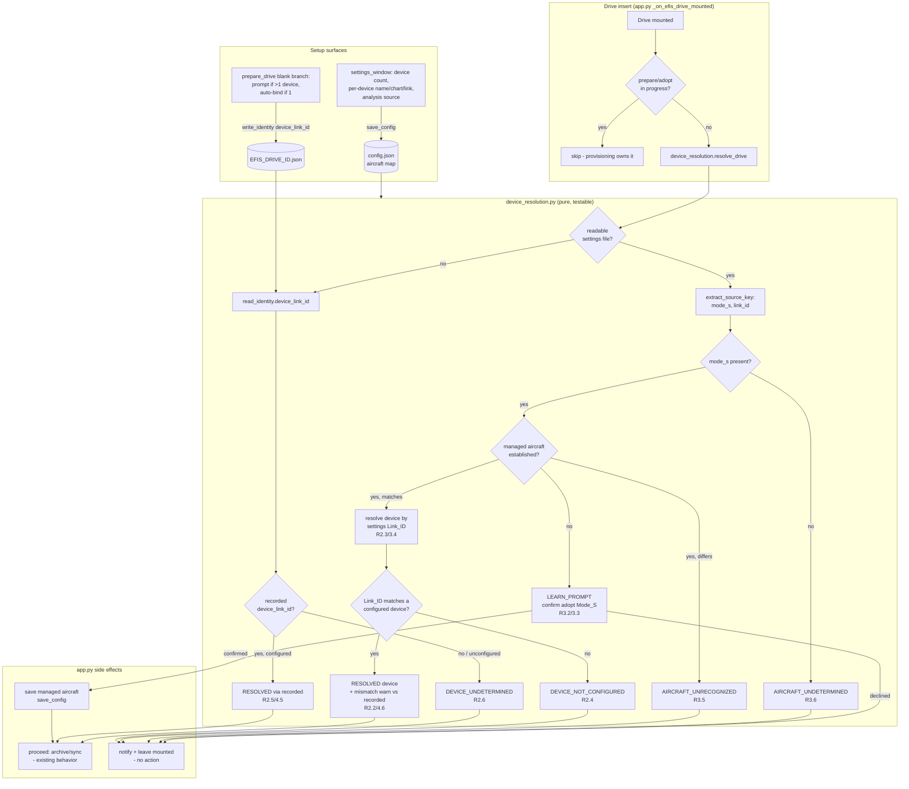

# Design Document: Multi-Device Settings — Increment 1 (Device Identity + DM Setup Foundation)

## Overview

This increment establishes the **foundation** for handling an aircraft with one
to three GRT displays. It does four things and nothing more:

1. **An aircraft-keyed configuration model** stored in `config.py`:
   `aircraft[Mode_S] -> { device_count, devices{Link_ID -> Device_Config},
   analysis_data_source }`. Exactly one aircraft is managed in this increment,
   but the stored shape is a map of aircraft so multi-aircraft later is a
   non-breaking extension (R1.1, R1.2).

2. **Drive-insert identity resolution**: when a drive is inserted, derive its
   identity with the already-shipped `extract_source_key` (`efis_settings.py`),
   verify the drive's Mode_S against the managed aircraft (learning the managed
   aircraft on first use with user confirmation), and resolve the drive to a
   configured device by Link_ID — with the **settings-file Link_ID
   authoritative** over any recorded binding (R2, R3, R4).

3. **Drive-to-device binding** persisted in the existing per-drive identity
   file `EFIS_DRIVE_ID.json`, extended with one new field `device_link_id`
   (R4.3, R6.6). Blank drives are bound at Prepare time.

4. **Setup UI** inside the DM menu-bar Settings surface
   (`settings_window.show_settings`): device count, per-device friendly
   name / chart-capable / Link_ID, and the analysis-data-source selection (R1,
   R5).

Because this is a **flight-critical** domain — settings identity decides which
device a settings file belongs to and whether a drive even belongs to the
managed aircraft — the design favours correctness over convenience at every
identity decision. The guiding rules:

- **Reuse, do not reinvent.** Identity comes from `extract_source_key`; the
  per-drive identity file comes from `read_identity` / `write_identity` /
  `_new_identity`; config persistence and migration follow the proven
  `migrate_settings_import` precedent; the drive-insert hook is the existing
  `_on_efis_drive_mounted` callback; the Settings UI extends
  `settings_window.py`.
- **Non-destructive on uncertainty.** Every "I can't confidently place this
  drive" branch follows the shipped `_on_adoption_candidate` precedent: log,
  post a best-effort notification, take NO archive/sync/push/eject action, and
  LEAVE THE DRIVE MOUNTED for the user (R2.4, R2.6, R3.5, R3.6).
- **Settings-file Link_ID is authoritative.** A recorded `device_link_id` is
  only a fallback for when no readable settings file is present (R2.2, R4.5,
  R4.6).
- **Single-device installs are untouched.** The common case never sees a new
  prompt and never depends on a learned Mode_S to keep working (R6).

Deferred work (per-device archiving, outbound sync/push, settings
explore/compare/restore, FDL enforcement, divergence warning, forget-aircraft)
is explicitly **out of scope** here and only acknowledged as a future consumer
of this foundation (see "Future Increments Consume This").

### Research notes and honest unknowns

- **`extract_source_key` already does the hard part.** Reading
  `efis_settings.py` confirmed `extract_source_key(parsed)` returns a
  `SourceIdentity(source_key, mode_s, link_id, flight_id)` with exactly the
  fallbacks the requirements cite: `Mode_S:Link_ID` when both present, bare
  Mode_S, `:Link_ID`, or `None` when neither is readable. This increment adds
  **no new parsing**; it only consumes this result. The verification primitive
  for R2/R3 is this function, used as-is.
- **The identity file already tolerates missing fields.** `read_identity`
  swallows `FileNotFoundError` / `JSONDecodeError` / `OSError` and returns
  `None` (corrupt == absent). Adding a new optional field `device_link_id` is
  therefore backward-compatible by construction: a pre-feature drive simply
  lacks the key, and `.get("device_link_id")` returns `None`. The schema-version
  bump is a provenance marker, not a read gate (see Data Models). Confirmed by
  reading `read_identity` / `write_identity` / `_new_identity`.
- **The config migration pattern is proven.** `migrate_settings_import` is
  already called from `load_config` after the `{**DEFAULT_CONFIG, **saved}`
  merge; it is idempotent, crash-safe on absent/legacy/malformed input, and
  uses a synthetic sentinel key (`LEGACY_SOURCE_KEY`) to carry legacy data
  forward without regression. R6.3 follows this exact shape with a parallel
  `migrate_aircraft_config`. Confirmed by reading `config.py`.
- **The menu-bar Settings window is hand-built PyObjC.** `settings_window.py`
  lays out fields imperatively (`_add_label` / `_add_text_field` /
  `_add_checkbox`, a running `y` cursor, a `saveClicked_` handler that reads
  each control back into `self.config`). The device-config UI additions follow
  that existing idiom rather than introducing a new UI framework. Confirmed by
  reading `settings_window.py`.
- **`_on_adoption_candidate` is the canonical "warn and leave mounted"
  precedent.** It logs, calls `self._notify(...)` inside a best-effort
  try/except, and deliberately takes no destructive action. Every
  not-confident-enough branch in this design reuses that shape. Confirmed by
  reading `app.py`.
- **Prepare Drive has a clear blank-drive branch.** In `prepare_drive`, the
  "Blank / no chart data" branch sets `adopt = False` and eventually spawns
  `_do_prepare_drive`. The device-binding prompt (R4.2/R4.4) hooks into this
  blank-drive Start-clean branch, writing `device_link_id` after the identity
  file is created. Confirmed by reading `prepare_drive` / `_do_prepare_drive`.

## Architecture

The feature is a **resolve-on-insert pipeline** plus a **setup surface**. The
pipeline runs when a drive mounts; the setup surface runs when the user opens
Settings or Prepare Drive. One new pure module, `device_resolution.py`, holds
the decidable resolution/classification logic so it is unit-testable without
rumps or a real drive; `app.py` wraps it with the actual notify/leave-mounted
side effects; `config.py` and `drive_updater.py` gain small, additive changes.



### Why a dedicated `device_resolution.py` module

Three options were considered for where the resolve/classify logic lives:

1. **Inline in `_on_efis_drive_mounted`.** Rejected: that method already mixes
   provisioning guards, status UI, notifications, and thread spawning, and it
   runs only against a real mounted drive. Folding the identity state machine in
   there would make the flight-critical decision logic untestable without a
   physical drive and a running menu-bar app.
2. **Extend `efis_settings.py`.** Rejected: `efis_settings.py` is the read-only
   settings-parsing/identity layer. Drive-to-device resolution additionally
   consults config (configured devices) and the per-drive identity file, which
   are concerns of `config.py` and `drive_updater.py`. Mixing those in would
   couple the parser to config and identity.
3. **New `device_resolution.py` (chosen).** A thin, pure orchestration module
   that takes already-parsed inputs (a `ParsedBackup` or `None`, the recorded
   identity dict or `None`, and the config) and returns a `ResolutionOutcome`
   describing *what kind* of situation this is and *which device* (if any) was
   resolved. It performs **no** side effects: `app.py` maps the outcome to
   notifications / leave-mounted / proceed. This keeps the entire decision table
   testable with plain dicts (see Testing Strategy) and keeps the flight-
   critical logic in one reviewable place.

**Decision:** resolution lives in a new pure module; `app.py` owns only the
I/O and the non-destructive side effects, reusing `_notify` and the
`_on_adoption_candidate` pattern.

### Where this inserts into `_on_efis_drive_mounted`

The existing `_on_efis_drive_mounted` already:

- short-circuits when `_is_provisioning(mount_point)` is true (prepare/adopt
  owns the drive), and
- otherwise spawns `_run_archive` on a daemon thread.

The resolution call is inserted **after** the provisioning guard and **before**
the archive is started. When resolution returns a terminal "leave mounted"
outcome, `_on_efis_drive_mounted` notifies and returns without archiving or
syncing. When resolution returns `RESOLVED` (or `LEARN_PROMPT` that the user
confirms), existing archive/sync behaviour proceeds unchanged. This placement
keeps the existing provisioning race-guard intact and ensures no drive from an
unrecognized aircraft or an unconfigured device is ever archived or synced.

## Components and Interfaces

### `device_resolution.py` (new module) — the resolution/classification state machine

Pure logic for R2/R3/R4 resolution. It never touches rumps, never ejects, never
archives; it returns a verdict the caller acts on.

```python
from dataclasses import dataclass
from enum import Enum
from typing import Optional

class ResolutionStatus(Enum):
    RESOLVED = "resolved"                      # device identified; proceed (R2.3, R3.4, R4.1, R4.5)
    LEARN_PROMPT = "learn_prompt"              # no managed aircraft yet; confirm Mode_S (R3.2)
    AIRCRAFT_UNRECOGNIZED = "aircraft_unrecognized"   # Mode_S present but != managed (R3.5)
    AIRCRAFT_UNDETERMINED = "aircraft_undetermined"   # Mode_S not derivable (R3.6)
    DEVICE_NOT_CONFIGURED = "device_not_configured"   # Link_ID matches no device (R2.4)
    DEVICE_UNDETERMINED = "device_undetermined"       # no settings + no usable recorded binding (R2.6)

@dataclass
class ResolutionOutcome:
    status: ResolutionStatus
    mode_s: Optional[str] = None           # derived Mode_S, when present
    link_id: Optional[str] = None          # authoritative Link_ID used for resolution
    device: Optional[dict] = None          # the resolved Device_Config (RESOLVED only)
    display_label: Optional[str] = None     # device label for notifications (RESOLVED only)
    binding_mismatch: bool = False         # settings Link_ID != recorded device_link_id (R4.6)
    recorded_link_id: Optional[str] = None # the recorded device_link_id, for the mismatch message
    message: str = ""                      # human-readable rationale / notification body

def resolve_drive(
    parsed: Optional["ParsedBackup"],   # from Settings_Parser, or None when no readable settings file
    recorded_identity: Optional[dict],  # from read_identity(mount_point), or None
    config: dict,                       # full app config (holds the aircraft map)
) -> ResolutionOutcome:
    ...
```

**Resolution algorithm (decidable, side-effect-free):**

1. **Identity branch (settings present).** When `parsed is not None`, call
   `extract_source_key(parsed)` (R2.1). Let `mode_s`, `link_id` be the derived
   values.

   a. **Mode_S undetermined** (`mode_s is None`): return
      `AIRCRAFT_UNDETERMINED` (R3.6). (This dominates: we never place a drive
      whose aircraft we cannot establish, even if a Link_ID is present.)

   b. **No managed aircraft established yet** (`managed_mode_s(config) is
      None`) and `mode_s` present: return `LEARN_PROMPT` carrying `mode_s`
      (R3.2). The caller prompts; on confirm it persists the managed aircraft
      and then re-runs resolution (now the "matches" branch applies). On
      decline the caller leaves the drive mounted and takes no action (R3.3).

   c. **Mode_S matches the managed aircraft** (`mode_s == managed_mode_s`):
      proceed to device-by-Link_ID (R3.4). The **settings-file Link_ID is
      authoritative** (R2.2):
      - If `link_id` matches a configured device's Link_ID → `RESOLVED` with
        that device (R2.3, R4.1). If a `recorded_identity.device_link_id`
        exists and differs from `link_id`, set `binding_mismatch=True` and
        `recorded_link_id` so the caller can report the mismatch, but **resolve
        to the settings Link_ID** regardless (R4.6).
      - If `link_id` matches **no** configured device → `DEVICE_NOT_CONFIGURED`
        (R2.4).
      - If `link_id` is `None` (settings readable but no Link_ID SID): fall
        through to the recorded-binding branch (step 2) — a readable settings
        file without a Link_ID cannot place the device itself.

   d. **Mode_S present but does not match** the managed aircraft: return
      `AIRCRAFT_UNRECOGNIZED` (R3.5).

2. **Recorded-binding branch (no usable settings Link_ID).** Reached when
   `parsed is None` (no readable settings file, R2.5) or settings were present
   but yielded no Link_ID:
   - If `recorded_identity` has a `device_link_id` that matches a configured
     device of the managed aircraft → `RESOLVED` via the recorded binding
     (R2.5, R4.5).
   - Otherwise → `DEVICE_UNDETERMINED` (R2.6).

   Note: the recorded-binding branch does not itself verify Mode_S (a blank/
   data-less drive carries no settings file to derive Mode_S from). This is the
   intended fallback for rotation of prepared drives; aircraft verification is a
   property of populated drives (R3.1 derives Mode_S "when a populated drive is
   inserted").

**Config accessor helpers** (small, defined in `device_resolution.py` or
`config.py`; see Data Models for the shape they read):

```python
def managed_mode_s(config: dict) -> Optional[str]:
    """Return the single managed aircraft's Mode_S, or None if not yet learned."""

def managed_aircraft(config: dict) -> Optional[dict]:
    """Return the managed aircraft record, or None if not yet learned."""

def configured_device(config: dict, link_id: str) -> Optional[dict]:
    """Return the Device_Config for a Link_ID under the managed aircraft, or None."""

def device_count(config: dict) -> int:
    """Return the managed aircraft's device_count (default 1 when not learned)."""
```

### Display-label helper (R1.6, R1.7, R5.3, R5.4)

One function, used by Settings, device pickers, and notifications, so the label
rule exists in exactly one place.

```python
def device_label(device: dict) -> str:
    """Compose a device's display label.

    - `Link N`                when no friendly name is set (R1.6, R5.4)
    - `{friendly name} (Link N)` when a friendly name is set (R1.7, R5.3)

    N is the device's Link_ID. A friendly name that is empty or all-whitespace
    is treated as unset (falls back to `Link N`).
    """
    link_id = device.get("link_id")
    name = (device.get("friendly_name") or "").strip()
    if name:
        return f"{name} (Link {link_id})"
    return f"Link {link_id}"
```

This helper lives in `config.py` (next to the aircraft-config accessors) so both
`device_resolution.py` and `settings_window.py` can import it without a cycle.

### `config.py` — aircraft-keyed model, defaults, and migration

See Data Models for the full schema. Three additive changes:

1. A new top-level `aircraft` key in `DEFAULT_CONFIG`, defaulting to `{}` (empty
   map = "managed aircraft not yet learned") (R1.1, R6.2).
2. A new `migrate_aircraft_config(config)` function, modelled exactly on
   `migrate_settings_import`, called from `load_config` right after
   `migrate_settings_import` (R6.3).
3. The label/accessor helpers above.

### `drive_updater.py` — identity-file `device_link_id` extension

`_new_identity` gains one field, `device_link_id` (default `None`), and
`IDENTITY_SCHEMA_VERSION` bumps `1 -> 2`. See Data Models for the compat
argument. Binding is written with the existing `write_identity`
(or `update_identity_provenance` when a drive already has an identity).

### `settings_window.py` — device-config UI additions

New controls, laid out with the existing `_add_label` / `_add_text_field` /
`_add_checkbox` idiom and read back in `saveClicked_`:

- **Device count** (R1.3, R1.4): a small integer field (or 1/2/3 segmented
  control). On save, a value outside 1–3 is **rejected** and the previous valid
  count retained (the field is reset to the stored value, mirroring the existing
  `try/except: pass` "keep previous value" behaviour used for the frequency
  fields).
- **Per-device rows** (R1.5, R5.2), one row per device index up to the device
  count, each with:
  - a **friendly name** text field (editable, R5.2),
  - a **chart-capable** checkbox — a plain user-declared boolean, with no model/
    catalog lookup (R1.8),
  - a **Link_ID** field/selector constrained to 1–3 (R1.9). On save, a Link_ID
    that collides with another device's Link_ID is **rejected** and the prior
    Link_ID assignments retained (R1.10).
- **Analysis-data-source** selector (R1.11, R1.12): a single-select (radio/
  popup) over the configured devices, labelled with `device_label(...)`, with
  **no capability gating** — any configured device may be chosen regardless of
  its chart-capable value (R1.12).

On save (R1.13, R5.7) the handler builds the managed aircraft record and calls
`save_config`; subsequent drive-insert resolutions read the updated config
(resolution always reads the live config passed in, so changes apply
immediately — R5.7). The device-config section renders only the managed
aircraft; if no Mode_S is learned yet, it edits a **pending** record stored
under a sentinel key and is re-keyed to the real Mode_S when it is learned (see
Data Models, "managed-aircraft-not-yet-learned").

The window height constant grows to fit the new section; the existing fields and
save/cancel wiring are unchanged.

### `app.py` — insert hook, learn prompt, mismatch message, Prepare binding

- **`_on_efis_drive_mounted`** (R2, R3, R5.5, R5.6): after the provisioning
  guard, parse the settings file (if present) and read the recorded identity,
  call `device_resolution.resolve_drive(...)`, and `match` on the status:
  - `RESOLVED` → proceed to archive/sync as today; if `binding_mismatch`, post a
    best-effort `_notify` reporting the mismatch (R4.6) but still proceed to the
    authoritative device. Resolution is automatic and non-blocking (R5.5, R5.6).
  - `LEARN_PROMPT` → prompt (rumps) to confirm adopting `mode_s` as the managed
    aircraft (R3.2). On confirm, persist and re-resolve; on decline, leave
    mounted, no action (R3.3).
  - `AIRCRAFT_UNRECOGNIZED` / `AIRCRAFT_UNDETERMINED` / `DEVICE_NOT_CONFIGURED` /
    `DEVICE_UNDETERMINED` → reuse the `_on_adoption_candidate` pattern: log,
    `_notify` the specific reason, take **no** archive/sync/push/eject action,
    leave mounted (R2.4, R2.6, R3.5, R3.6).
- **Prepare Drive binding hook** (R4.2, R4.3, R4.4, R5.5, R6.4, R6.5): in the
  blank-drive Start-clean branch of `prepare_drive` (the `adopt = False` path
  that spawns `_do_prepare_drive`), after the identity file is written:
  - if `device_count(config) > 1`: prompt the user to choose which configured
    device (picker labelled with `device_label(...)`) and record the chosen
    device's Link_ID (R4.2, R4.3);
  - if `device_count(config) == 1`: bind to that single device **without
    prompting** (R4.4, R6.5);
  - write the binding via `write_identity` / `update_identity_provenance`
    setting `device_link_id` (R4.3).

## Data Models

### Aircraft-keyed configuration (`config.py`)

The new top-level `aircraft` key sits **alongside** the existing keys
(`tail_number`, `chart_types`, `num_cylinders`, `settings_import`, …) and does
not alter any of them. Shape:

```jsonc
{
  // ... all existing DEFAULT_CONFIG keys unchanged ...

  "aircraft": {
    // Map keyed by Mode_S (ICAO 24-bit hex string, e.g. "A60670").
    // Empty map = managed aircraft not yet learned (R1.1, R6.2).
    // This increment ever contains AT MOST ONE real aircraft entry
    // (plus possibly the pending sentinel below), but the map SHAPE is
    // forward-compatible with multi-aircraft (R1.2).
    "A60670": {
      "device_count": 2,                 // 1..3 inclusive (R1.3)
      "devices": {
        // Map keyed by Link_ID string "1"|"2"|"3" (R1.5, R1.9).
        "1": {
          "link_id": "1",                // redundant-but-explicit position key (R1.5)
          "friendly_name": "",           // "" => label is "Link 1" (R1.6)
          "chart_capable": true          // user-declared boolean only (R1.8)
        },
        "2": {
          "link_id": "2",
          "friendly_name": "Backup Mini", // label is "Backup Mini (Link 2)" (R1.7)
          "chart_capable": false
        }
      },
      "analysis_data_source": "1"        // Link_ID of the one analysis-source device (R1.11)
    }
  }
}
```

**Managed-aircraft-not-yet-learned representation.** Before the Mode_S is
learned (R3.2), there is no real key to store the aircraft under, but the user
may still have opened Settings and declared devices. This is represented with a
reserved **pending** sentinel key that cannot collide with a real Mode_S (a real
Mode_S is ICAO hex; the sentinel is chosen to be non-hex), exactly analogous to
`LEGACY_SOURCE_KEY` in `settings_import`:

```python
# config.py
PENDING_AIRCRAFT_KEY = ":pending"   # not a valid Mode_S; holds pre-learn device config
```

`managed_mode_s(config)` returns the single **real** (non-sentinel) key if one
exists, else `None`. When the Mode_S is learned on insert, the pending record
(if any) is re-keyed from `:pending` to the real Mode_S; if no pending record
exists, a default single-device record is created under the real Mode_S. This
keeps "the user configured devices before any drive was inserted" working
without inventing a fake Mode_S.

**Device count vs. devices map.** `device_count` is the declared number of
displays (1–3). `devices` holds the Device_Config records actually configured,
keyed by Link_ID. They are allowed to differ transiently while the user edits;
validation at save time (R1.4, R1.9, R1.10) keeps the stored record consistent.

**Single-device default.** When `aircraft` is empty, every resolution treats the
install as single-device (`device_count` defaults to 1) and the one implied
device resolves without prompting (R6.1, R6.4).

### Config migration — `migrate_aircraft_config` (R6.3)

Modelled byte-for-byte on `migrate_settings_import`: mutate-and-return,
idempotent, crash-safe, defaults where attributes are absent, called from
`load_config` after the defaults merge.

```python
def migrate_aircraft_config(config: dict) -> dict:
    """Normalize a pre-aircraft-keyed config into the aircraft-keyed map shape.

    A config that predates this feature has NO top-level `aircraft` key (the
    defaults merge supplies `{}`), or a flat/implicit single-aircraft shape.
    This presents it as the aircraft-keyed map without raising (R6.3):

      - `aircraft` missing or not a dict  -> set to {} (managed aircraft not
        yet learned); single-device behaviour applies until a Mode_S is learned.
      - `aircraft` already a non-empty map -> leave untouched (already migrated).
      - a legacy flat single-aircraft record (if a prior interim shape ever
        stored device fields at top level) -> fold it into the pending record
        under PENDING_AIRCRAFT_KEY, defaulting device_count=1 and a single
        chart-capable device at Link_ID "1" where attributes are absent.

    The Mode_S is bound later, on insert, per Requirement 3 — migration never
    invents a Mode_S. Mutates and returns `config`; safe to call repeatedly.
    """
    aircraft = config.get("aircraft")
    if not isinstance(aircraft, dict):
        config["aircraft"] = {}
        return config
    # Already-keyed map (real Mode_S keys and/or the pending sentinel): nothing
    # to do. Absence of any key is the valid "not yet learned" state.
    return config
```

Chained in `load_config`:

```python
config = {**DEFAULT_CONFIG, **saved}
migrate_settings_import(config)   # existing
migrate_aircraft_config(config)   # new — same precedent, same guarantees
return config
```

Because `DEFAULT_CONFIG["aircraft"] = {}` already supplies the key on merge, the
common upgrade path (old config lacking the key) needs no special handling — the
merge plus the `not isinstance` guard yields the empty "not yet learned" map
without raising (R6.2).

### Identity-file extension — `device_link_id` (R4.3, R6.6)

`EFIS_DRIVE_ID.json` gains one optional field and the schema version bumps:

```python
# drive_updater.py
IDENTITY_SCHEMA_VERSION = 2   # was 1; bump records the new device_link_id field
```

`_new_identity` adds the field, defaulting to `None` (no binding yet):

```python
return {
    "schema_version": IDENTITY_SCHEMA_VERSION,   # now 2
    "id": str(uuid.uuid4()),
    "kind": IDENTITY_KIND,
    "volume_uuid": _volume_uuid(mount_point),
    "label": label,
    "created": _now_iso(),
    "prepared_by": f"EFISDataManager {__version__} on {socket.gethostname()}",
    "device_link_id": None,     # NEW (R4.3): Link_ID "1"|"2"|"3" once bound
    "last_sync_started": None,
    "last_sync_completed": None,
    "last_sync_result": None,
    "last_sync_families": [],
    "sync_count": 0,
    "data_cycle": None,
}
```

**Backward-read compatibility (R6.6).** This change is read-compatible by
construction:

- A drive prepared **before** this feature has `schema_version: 1` and **no**
  `device_link_id` key. `read_identity` still parses it (it never validated the
  version), and resolution reads the binding as
  `recorded_identity.get("device_link_id")` → `None`, which routes to the
  recorded-binding fallback's "no recorded binding" case (R2.6) rather than
  crashing. All existing fields (`id`, `kind`, `volume_uuid`, provenance) are
  preserved exactly (R6.6).
- `update_identity_provenance` already preserves `id` and `kind` across merges
  and leaves unrelated fields intact, so writing `device_link_id` onto an older
  drive adds the field without disturbing the v1 fields.
- The version bump is **informational provenance only**; nothing in
  `read_identity` / `resolve_drive_id` gates on `schema_version`, so a v1 drive
  and a v2 drive are both readable. Writing refreshes the drive to v2.

## Correctness Properties

*A property is a characteristic or behavior that should hold true across all
valid executions of a system — essentially, a formal statement about what the
system should do. Properties serve as the bridge between human-readable
specifications and machine-verifiable correctness guarantees.*

The testable surface of this increment is a set of **pure functions**: the
config migration, the display-label helper, and the resolution/classification
state machine. These have clear input/output behaviour over a large input space
(Mode_S × Link_ID × settings-present × recorded-binding × config), so
property-based testing applies to them. The UI (PyObjC layout), the rumps
prompts, and the actual archive/sync side effects are **not** amenable to PBT
(UI rendering and side-effect-only operations) and are covered by example/
integration tests instead (see Testing Strategy).

### Property 1: Migration idempotency

*For any* config dict (empty, missing `aircraft`, already-keyed map, or legacy
flat shape), applying `migrate_aircraft_config` twice yields the same result as
applying it once, and never raises.

**Validates: Requirements 6.2, 6.3**

### Property 2: Migration preserves existing keys

*For any* config dict, `migrate_aircraft_config` leaves every non-`aircraft`
key byte-identical and only ever adds or normalizes the `aircraft` key.

**Validates: Requirements 6.2, 6.3**

### Property 3: Label composition round-trips the Link_ID

*For any* device record, `device_label(device)` always contains the substring
`Link {link_id}`; it equals `Link {link_id}` exactly when the friendly name is
empty or all-whitespace, and equals `{friendly_name} (Link {link_id})` exactly
when a non-whitespace friendly name is present.

**Validates: Requirements 1.6, 1.7, 5.3, 5.4**

### Property 4: Settings-file Link_ID is authoritative

*For any* populated drive whose settings yield a Link_ID matching a configured
device, `resolve_drive` resolves to the device identified by the **settings-file
Link_ID**, regardless of any `device_link_id` recorded in the identity file;
when the recorded binding differs, the outcome additionally flags
`binding_mismatch`.

**Validates: Requirements 2.2, 4.1, 4.6**

### Property 5: Recorded binding is used only when no settings Link_ID is present

*For any* drive with no readable settings file (or settings without a Link_ID),
`resolve_drive` resolves to the device named by the recorded `device_link_id`
when that Link_ID is configured, and returns `DEVICE_UNDETERMINED` when neither
a settings Link_ID nor a configured recorded binding is available.

**Validates: Requirements 2.5, 2.6, 4.5**

### Property 6: Aircraft verification gates device resolution

*For any* populated drive, `resolve_drive` returns `RESOLVED` (or
`LEARN_PROMPT`) **only** when the derived Mode_S is present AND (no managed
aircraft is established yet, or the Mode_S equals the managed aircraft's
Mode_S). A derived Mode_S that is absent yields `AIRCRAFT_UNDETERMINED`; a
present Mode_S that differs from the managed aircraft yields
`AIRCRAFT_UNRECOGNIZED`. In no case does a non-matching or undetermined aircraft
produce a `RESOLVED` outcome.

**Validates: Requirements 3.1, 3.4, 3.5, 3.6**

### Property 7: Unconfigured Link_ID never resolves to a device

*For any* populated drive belonging to the managed aircraft whose settings
Link_ID matches no configured device, `resolve_drive` returns
`DEVICE_NOT_CONFIGURED` and never returns a device.

**Validates: Requirements 2.3, 2.4**

### Property 8: Resolution is deterministic

*For any* fixed inputs (`parsed`, `recorded_identity`, `config`),
`resolve_drive` returns the same `ResolutionStatus` and the same resolved device
on every call (no hidden state, no ordering dependence).

**Validates: Requirements 2.3, 3.4, 4.1**

### Property 9: Learn binds the managed aircraft only on confirmation

*For any* insert while no managed aircraft is established, with a present
derived Mode_S, `resolve_drive` returns `LEARN_PROMPT`; the managed aircraft is
persisted to config **only** when the caller confirms, and declining leaves the
`aircraft` map with no real Mode_S key.

**Validates: Requirements 3.2, 3.3**

### Property 10: Device-count and Link_ID validation preserve prior valid state

*For any* prior valid managed-aircraft record and any attempted edit, saving a
device count outside 1–3 retains the previous device count, and saving a Link_ID
that duplicates another configured device's Link_ID retains the previous Link_ID
assignments.

**Validates: Requirements 1.4, 1.9, 1.10**

## Error Handling

- **Unreadable / corrupt settings file.** `Settings_Parser.parse` raises
  `SettingsParseError` on an unreadable file or zero valid pairs; the insert
  hook treats a parse failure the same as "no readable settings file" and
  passes `parsed=None` to `resolve_drive`, which falls to the recorded-binding
  branch (R2.5) and ultimately `DEVICE_UNDETERMINED` (R2.6) if nothing places
  the drive. No exception escapes the insert callback.
- **Corrupt / missing identity file.** `read_identity` already returns `None`
  for a missing or corrupt file; resolution treats a `None` identity as "no
  recorded binding".
- **Undetermined aircraft or device.** All four non-confident outcomes
  (`AIRCRAFT_UNRECOGNIZED`, `AIRCRAFT_UNDETERMINED`, `DEVICE_NOT_CONFIGURED`,
  `DEVICE_UNDETERMINED`) are **non-destructive**: no archive, no sync, no push,
  no eject; the drive is left mounted and a best-effort notification explains
  why (R2.4, R2.6, R3.5, R3.6). This mirrors `_on_adoption_candidate`.
- **Best-effort notifications.** `_notify` is wrapped in try/except in `app.py`;
  a failed toast never disrupts monitoring, exactly as today.
- **Binding write failure at Prepare.** `write_identity` is atomic (temp +
  fsync + `os.replace` + `os.sync`) and raises on failure after cleaning up its
  temp file. A failed `device_link_id` write surfaces through the existing
  Prepare error path (`_do_prepare_drive`'s try/except that notifies "Prepare
  Drive Failed"); the drive is not left in a half-bound state because the
  binding write is a single atomic replace.
- **Config save failure.** `save_config` propagates OSError; the Settings save
  handler surfaces it as it does today (the user can retry). `load_config`
  already resets to defaults on a corrupt config file.
- **Invalid user input in Settings.** Out-of-range device count and duplicate
  Link_ID are rejected at save time with the previous valid values retained
  (R1.4, R1.10), following the existing "keep previous value" idiom.

## Testing Strategy

The project uses **pytest** (`./venv/bin/python -m pytest`, 696 tests currently
passing) and has **Hypothesis** available (property tests already exist for
chunked writes). This increment adds tests at three levels.

### Unit tests (examples, edge cases, error conditions)

- **Config migration** (`migrate_aircraft_config`): empty config; config
  missing `aircraft`; already-keyed single-aircraft map; pending-sentinel-only
  config; malformed `aircraft` (non-dict); and the full `load_config` chain
  (defaults merge → `migrate_settings_import` → `migrate_aircraft_config`) on a
  pre-feature config file, asserting no raise and single-device defaults
  (R6.2, R6.3).
- **Identity-file compat**: `_new_identity` includes `device_link_id: None` and
  `schema_version: 2`; `read_identity` on a hand-written **v1** JSON (no
  `device_link_id`) parses and `.get("device_link_id")` is `None`;
  `update_identity_provenance` adds `device_link_id` to a v1 drive while
  preserving `id`, `kind`, `volume_uuid`, and provenance fields (R4.3, R6.6).
- **Label helper**: `Link 2` with no name; `Backup Mini (Link 2)` with a name;
  whitespace-only name falls back to `Link N` (R1.6, R1.7, R5.3, R5.4).
- **Resolution state machine — table-driven** over the
  (Mode_S × Link_ID × settings-present × recorded-binding × config) space, one
  row per expected status. Representative rows:

  | settings | derived Mode_S | managed Mode_S | settings Link_ID | configured? | recorded device_link_id | expected status | req |
  |----------|----------------|----------------|------------------|-------------|--------------------------|-----------------|-----|
  | present  | A60670         | A60670         | 1                | yes         | —                        | RESOLVED        | 2.3 |
  | present  | A60670         | A60670         | 1                | yes         | 2 (differs)              | RESOLVED + mismatch | 4.6 |
  | present  | A60670         | A60670         | 3                | no          | —                        | DEVICE_NOT_CONFIGURED | 2.4 |
  | present  | A60670         | (none)         | 1                | n/a         | —                        | LEARN_PROMPT    | 3.2 |
  | present  | B11111         | A60670         | 1                | —           | —                        | AIRCRAFT_UNRECOGNIZED | 3.5 |
  | present  | (none)         | A60670         | 1                | —           | —                        | AIRCRAFT_UNDETERMINED | 3.6 |
  | absent   | n/a            | A60670         | n/a              | —           | 2 (configured)           | RESOLVED (recorded) | 2.5/4.5 |
  | absent   | n/a            | A60670         | n/a              | —           | — / unconfigured         | DEVICE_UNDETERMINED | 2.6 |

- **Prepare binding**: single-device install binds without prompting and writes
  `device_link_id` (R4.4, R6.5); multi-device install records the chosen
  device's Link_ID (R4.2, R4.3). The rumps prompt is mocked; the assertion is on
  the `write_identity` payload.
- **Settings save validation**: device count outside 1–3 rejected with prior
  retained (R1.4); duplicate Link_ID rejected with prior retained (R1.10);
  analysis-source selectable regardless of `chart_capable` (R1.12). The PyObjC
  controls are exercised through the save handler's pure validation path (the
  validation is factored out of the ObjC method into a plain function so it is
  testable without a window).

### Property-based tests (Hypothesis, ≥100 iterations each)

Each property test runs a minimum of 100 generated iterations and is tagged with
a comment referencing its design property. Tag format:
**Feature: multi-device-settings, Property {number}: {property_text}**

- **Property 1 / 2 — migration idempotency & key preservation**: generate
  arbitrary config dicts (including the pending sentinel and legacy shapes);
  assert `migrate_aircraft_config(migrate_aircraft_config(c)) ==
  migrate_aircraft_config(c)` and that non-`aircraft` keys are untouched. A
  natural fit for PBT (idempotence pattern over a large input space).
- **Property 3 — label composition**: generate random friendly names (including
  empty/whitespace/Unicode) and Link_IDs; assert the `Link N` substring
  invariant and the exact-form cases. (Invariant + metamorphic pattern.)
- **Properties 4–8 — resolution determinism & classification**: generate random
  `ParsedBackup`-like SID maps, recorded identities, and aircraft configs;
  assert the authoritative-Link_ID invariant (4), the recorded-fallback
  invariant (5), the aircraft-gating invariant (6, "never RESOLVED on a
  non-matching/undetermined aircraft"), the unconfigured-Link invariant (7), and
  determinism by calling `resolve_drive` twice and comparing (8). These are the
  flight-critical invariants and the strongest reason to use PBT here: the input
  space (Mode_S present/absent/matching, Link_ID configured/not, settings
  present/absent, recorded binding present/absent/matching) is combinatorial,
  and 100+ generated combinations exercise far more of it than the example table
  alone.

### Not property-tested (by design)

- **PyObjC Settings layout and rumps prompts** — UI rendering and interaction;
  covered by the extracted-validation unit tests plus manual smoke
  verification. PBT does not apply.
- **Archive/sync side effects and notifications** — side-effect-only operations
  with no return value to quantify over; covered by mock-based unit tests
  asserting that the terminal "leave mounted" outcomes take no action and
  `RESOLVED` proceeds.
- **Real-drive insert end-to-end** — hardware/OS integration; covered by the
  existing manual drive-insert smoke procedure, out of scope for automated PBT.

### Verification

Run the full suite with `./venv/bin/python -m pytest`; the 696 existing tests
must continue to pass (R6 backward-compat is partly proven by the unchanged
single-device suite), and the new unit + property tests must pass.

## Backward Compatibility (R6)

- **No multi-device config present → single-device behaviour (R6.1).** An empty
  `aircraft` map means "not yet learned". Resolution defaults `device_count` to
  1 and resolves the single implied device without prompting; the insert path
  behaves as it does today.
- **`load_config` supplies defaults without error (R6.2).** `DEFAULT_CONFIG`
  carries `aircraft: {}`, so the `{**DEFAULT_CONFIG, **saved}` merge always
  yields the key; `migrate_aircraft_config`'s `not isinstance` guard handles any
  malformed value without raising.
- **Flat/implicit single-aircraft config is presented as one managed record
  (R6.3).** `migrate_aircraft_config` normalizes to the map shape, deferring the
  Mode_S binding to the learn-on-insert flow (R3) and defaulting absent
  per-aircraft attributes. It never invents a Mode_S.
- **Single device resolves without prompting (R6.4, R6.5).** With exactly one
  configured device, both insert resolution and Prepare binding skip the
  device-selection prompt.
- **Identity schema preserved (R6.6).** Adding `device_link_id` and bumping
  `IDENTITY_SCHEMA_VERSION` is read-compatible: v1 drives (no `device_link_id`)
  still read via `read_identity`, nothing gates on the version, and provenance
  merges preserve `id`/`kind`/existing fields. Drives prepared before this
  feature remain fully usable.

## Future Increments Consume This

This increment is deliberately the foundation; the following **consume** it and
are **not** designed here (they are tracked in `BACKLOG.md`):

- **Roadmap item #1 — Multi-device handling.** Per-device inbound archiving
  (keyed by the Link_ID this increment resolves), outbound sync/push to
  chart-capable devices (reading the `chart_capable` flag and the per-device
  binding), and FDL/logbook enforcement to the one `analysis_data_source` device
  declared here. The aircraft-keyed map and the `device_link_id` binding are the
  contract those features read.
- **Roadmap item #2 — Settings management.** The settings explorer / compare /
  version-restore and the divergence warning build on the per-device identity
  and Mode_S verification established here (the Source_Key and the resolved
  device are their inputs).

Multi-aircraft keying/management, and a "forget the managed aircraft" action,
remain deferred (the aircraft-keyed map shape makes multi-aircraft a
non-breaking extension, but no switcher UI or lifecycle management is in scope).
